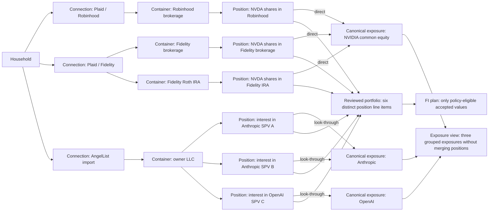
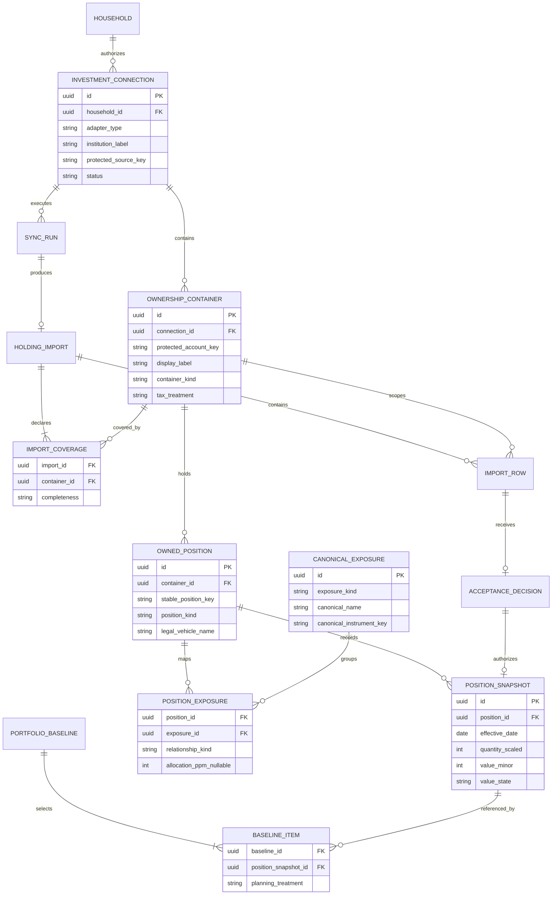

# ADR 005: Multi-source holdings identity

- Status: Accepted; released in M9
- Date: 2026-08-15
- Release: PR #82, merge `66f157aa8143e6eff09d03b14ae915c17d4c1025`, exact-SHA
  workflow `31960175926`

## Context

Keel must support more than one investment institution and more than one account
at the same institution without losing legal ownership context or double
counting economic exposure. The same public security may be held in a Robinhood
brokerage account, a Fidelity brokerage account, and a Fidelity IRA. The same
private company may be reached through several legally distinct SPVs. Those are
separate owned positions even when their economic exposure is the same.

The shipped model already provides important foundations:

- `holding_positions` represents the legal asset owned by the household;
- `holding_position_exposures` keeps an underlying company or fund separate from
  that legal asset;
- `holding_position_snapshots` and review decisions are append-only; and
- the protected Plaid Investments position key includes both account identity
  and security identity, so the same security in two accounts can remain
  separate.

At the time of this decision, the public-holdings path was institution-specific:
the accepted provider contract enumerated Robinhood and AngelList, the Plaid
flow validated only Robinhood, a position had no first-class ownership-container
relationship, and missing-position reconciliation ranged across a provider
instead of an explicitly covered connection and account. Adding `fidelity` to
the provider enum would therefore have been insufficient and could have created
false missing positions or accidental merges. M9.1 through M9.8 materialized the
canonical foundation, provider-neutral Investments path, authoritative position
and exposure projections, and multi-institution owner experience.

This ADR defines the canonical logical and persistence model. Keel has no live
user data, so implementation uses one direct pre-live cutover instead of
carrying parallel schemas, backfills, or read paths. The relationships and
invariants below are normative.

## Decision

### Canonical concepts

| Record                    | Canonical meaning                                                               | Example                                                                   | Identity and scope                                                                                                                                        |
| ------------------------- | ------------------------------------------------------------------------------- | ------------------------------------------------------------------------- | --------------------------------------------------------------------------------------------------------------------------------------------------------- |
| Investment connection     | One authorized external source or explicit manual/import source                 | A Plaid Item for Fidelity; an AngelList export profile                    | Household + adapter type + a protected stable source key. Institution display text is not identity.                                                       |
| Ownership container       | The account, tax wrapper, or ownership entity in which an asset is legally held | Fidelity brokerage; Fidelity Roth IRA; owner LLC                          | Connection + protected stable provider account key, or an explicit reviewed manual identity. Labels and masks are display metadata only.                  |
| Owned position            | One legal asset held in one ownership container                                 | NVDA shares in the Fidelity IRA; an LP interest in Anthropic SPV A        | Container + stable source position key. Exposure name, ticker, and institution name alone never identify a position.                                      |
| Position snapshot         | Dated facts observed for one owned position                                     | Quantity, cost basis, administrator value, or status on an effective date | Append-only and attributable to an import row plus an acceptance decision. Unknown and unavailable values remain explicit.                                |
| Canonical exposure        | The underlying security, company, fund, or other economic exposure              | NVIDIA common equity; Anthropic; OpenAI                                   | Independent of connection, institution, account, and legal vehicle. Provider text does not become canonical without deterministic or reviewed resolution. |
| Position-exposure mapping | A direct or look-through relationship between a position and an exposure        | An SPV interest maps to Anthropic                                         | Many-to-many. An allocation is integer parts per million when known and remains unknown otherwise.                                                        |
| Import coverage           | The exact connection and containers a complete observation represents           | One Fidelity Item covering a brokerage account and an IRA                 | Only complete, validated coverage can support a `not reported` proposal, and only inside the covered containers.                                          |
| Portfolio baseline item   | One exact accepted position snapshot selected for a reviewed baseline           | The latest accepted Fidelity-IRA NVDA snapshot                            | A position appears at most once in a baseline. Exposure joins never create extra baseline value.                                                          |

Every imported or manually entered holding follows the same chain:

`household → investment connection → ownership container → owned position → position snapshot`

The exposure relationship is deliberately orthogonal:

`owned position ↔ position exposure ↔ canonical exposure`

### Concrete relationship example

All names and relationships below are illustrative and contain no portfolio
values.

This example produces six legal position records, not three. The exposure view
can answer “what is the household's total NVIDIA exposure?” while the position
view still answers “which account owns each share?” The reviewed portfolio uses
each accepted position once; FI policy separately determines which accepted
values are usable in the plan.

### Logical relationship model

### Identity and reconciliation invariants

1. A legal position and an economic exposure are different records.
2. The same exposure held through different containers or legal vehicles remains
   separate positions. Keel never merges positions merely because tickers,
   company names, or exposure mappings match.
3. One position belongs to exactly one ownership container. A reconnect may
   reauthorize the same connection and container; it must not create a new
   position lineage when stable identity is unchanged.
4. A position may map to zero, one, or many canonical exposures. Zero means
   unresolved, not no exposure. A multi-exposure position contributes monetary
   values to exposure totals only when reviewed allocation parts are known and
   valid; otherwise the relationship is shown without duplicating its full value
   across exposures.
5. A Portfolio Baseline selects position snapshots, never exposure rows. Each
   position is counted at most once, while its planning treatment still keeps
   private paper, locked value, and unavailable value distinct from usable
   liquidity.
6. A source omission is evaluated only against prior positions in the same
   connection and an explicitly, completely covered container. It creates a
   reviewable `not reported` state or exception, never an inferred sale, closed
   account, zero value, or deletion. Partial or ambiguous coverage creates no
   omission claim.
7. External observations remain evidence. A snapshot becomes accepted only
   through an explicit review or a recorded deterministic policy decision.
   Accepted snapshots, decisions, baselines, and exposure mappings are
   append-only; corrections supersede rather than rewrite history.
8. Disconnecting or pausing a connection stops future retrieval and removes
   credentials according to policy, but it does not delete accepted position
   history or silently change a baseline.

### Sync and review behavior

For every acquisition run, Keel must:

1. validate the external response at the boundary and resolve the exact
   investment connection;
2. resolve each reported account or ownership entity to an ownership container
   using protected stable identifiers, never a mutable display label;
3. bind every import row to one container before attempting to match a position;
4. compare the row only with positions in that container;
5. record the containers for which the source response is complete;
6. stage new or changed facts and identity ambiguity for review, or record the
   deterministic policy decision that accepted a supported unchanged identity;
7. compute omissions only within completely covered containers; and
8. append accepted position snapshots without altering any other connection,
   container, position, baseline, or forecast.

A single connection may return several containers, such as a Fidelity brokerage
account and IRA. A failed Fidelity check cannot make a Robinhood position
missing. A complete Fidelity brokerage observation cannot make a Fidelity IRA
position missing unless that IRA is also explicitly included in the observation
coverage.

### Baseline and exposure views

Keel provides two projections over the same accepted facts:

- **Position view:** grouped by institution, ownership container, and legal
  position. This is the source of truth for review, provenance, tax wrapper,
  quantity, cost basis, value state, and baseline inclusion.
- **Exposure view:** grouped by canonical exposure with drill-down to every
  contributing position. It is a derived concentration view and cannot create,
  merge, update, or delete positions.

The position view is authoritative for money. A direct position can contribute
its accepted value once to one exposure. A fund or SPV with several underlying
exposures contributes allocated values only when the allocations are reviewed
and sum to at most 1,000,000 parts per million. Unallocated value stays visible
at the position level and is not manufactured in the exposure view.

### Pre-live cutover and implementation boundary

Every current environment is synthetic and disposable. Implementation therefore
must establish the canonical model directly:

1. add the canonical connection, ownership-container, import-coverage, and
   exposure identities as the only relationship contract;
2. rebuild any pre-live D1 database from the checked-in migration chain rather
   than backfilling provider-specific records or retaining a second read path;
3. require each upgraded ingestion writer to resolve the exact connection and
   ownership container before it writes an accepted position association;
4. keep `holding_positions` and accepted snapshots authoritative for money;
   canonical relationship and exposure records cannot manufacture baseline
   value;
5. generalize the Plaid Investments adapter, API contracts, and UI from
   Robinhood-specific naming to institution metadata, then prove the model with
   at least one additional institution such as Fidelity;
6. scope imports, omissions, refreshes, disconnects, and webhook processing to
   the exact connection and covered containers;
7. preserve the existing review boundary, integer money arithmetic, synthetic
   fixtures, and append-only baselines; and
8. add invariant tests for same-exposure/different-account positions,
   same-company/different-SPV positions, partial coverage, reconnects,
   aggregation, and double-count prevention before enabling another real
   institution.

Once any environment is authorized to retain real user data, database resets and
deployed-migration rewrites are prohibited. From that point, schema changes must
be forward-only and accepted history remains append-only.

### 2026-08-16 operational amendment: retained accepted history

The rebuild instruction above governs disposable pre-live transition databases;
it is not permission to reset an environment that retains accepted review
history. Such an environment follows the forward-only rule even when the public
repository and its release fixtures remain synthetic-only.

A forward repair may add missing canonical relationship records only when it:

1. derives the position, connection, container, and evidence from an accepted
   application and reuses an existing row/container association when present;
2. creates a separate unresolved container only when accepted history has no
   proven container identity, then records ambiguous coverage so omission
   inference remains disabled;
3. preserves every accepted position, snapshot, value, baseline, plan, goal,
   forecast, and mapping decision;
4. reconciles exposures only from a protected strong public identifier or an
   existing reviewed company ID, never from display text; and
5. adds a write-time invariant that prevents the inconsistent state from
   recurring.

Migration `0026_reconciled_holding_ownership.sql` is this bounded repair. It is
not a compatibility read, a second ownership model, or a general authorization
to backfill accepted financial facts.

Migration `0027_retained_public_exposure_identity.sql` extends the same bounded
rule to accepted public rows whose strong-identifier columns did not yet exist.
The original private source object remains the evidence boundary: Keel must
match its recorded byte length and SHA-256, validate the provider response, and
append only a protected checksum-valid CUSIP, ISIN, or SEDOL. The accepted row,
position, snapshot, account provenance, and value remain unchanged.

Migration `0028_provider_scoped_public_exposure.sql` adds a narrower fallback
for a validated Plaid source that has no checksum-valid global identifier. An
exact Plaid security ID may group eligible public securities only inside the
same protected Item identity. It cannot merge positions across Items or
institutions and it does not make the provider identifier household-global.
Ticker, company name, and display text remain insufficient. Cash,
cryptocurrency, unsupported security types, missing source evidence, and invalid
source evidence remain unresolved. Global CUSIP, ISIN, or SEDOL always takes
precedence over the Item-scoped fallback.

Migration `0029_structured_asset_exposure.sql` resolves the structured asset
types intentionally excluded by `0028`. Exact USD cash positions share one
household currency exposure across investment connections. Cryptocurrency may
share an exposure only through its exact Plaid security ID inside the same
protected Item; it remains outside FI planning. Neither rule uses ticker, name,
legal-vehicle, owner, or account text. Unsupported types and any row without
checksum-verified structured evidence remain unresolved. These mappings do not
merge legal positions or accounts and cannot change accepted value or Portfolio
Baseline membership.

Migration `0030_reconnected_position_continuity.sql` repairs a different
relationship: a retained reviewed-history position followed by a newly
authorized Plaid Item can represent one legal holding at two observation dates.
The accepted positions and snapshots remain immutable. Keel records a one-to-one
continuation only when the reviewed-history record and the newer source record
have the same normalized legal vehicle and account label, exact ticker,
instrument type, currency, quantity, and cost basis, the newer snapshot is
later, and neither side has another candidate. When both sides carry a protected
global security identity, those identities must agree; conflicting identity
fails closed. The predecessor then leaves the current Position, Exposure, and
Portfolio Baseline projections while its accepted source and snapshot remain
auditable. This is a position-continuity decision, not text-based exposure
identity and not a value rewrite.

Migration `0031_reconnected_position_continuity_one_sided_identity.sql` refines
only the protected-identity corroboration rule for a valid reconnect shape where
the successor has a global identifier that the retained predecessor lacks. One
missing identifier no longer vetoes an otherwise exact, unique structured
continuation; it is never copied to or inferred for the predecessor. If both
sides have protected global identities, they must match. All snapshot facts,
directionality, provenance, and one-to-one uniqueness gates from `0030` remain
unchanged.

Migration `0037_private_provider_position_continuity.sql` applies the same
one-to-one continuity model when a live AngelList, Tokenfolio, or Sydecar
connection follows reviewed history. It requires the same provider, adapter,
position kind, normalized legal vehicle, ownership label, reported exposure,
investment date, instrument, and currency, plus exact invested and allocation
amounts. The live observation must be newer, and each side must have exactly one
candidate. Company identity alone is insufficient: distinct SPVs and ambiguous
matches remain separate. The predecessor leaves current Position, Exposure, and
Portfolio Baseline projections without changing either accepted snapshot or its
value.

The canonical Position and Exposure projections are the only Holdings list
source. The Alpha holding collection may supply detail content for a canonical
position ID, but the UI must not union an Alpha-only record back into either
projection. Otherwise an intentionally retired continuity predecessor can
reappear as an unresolved current position after the database has excluded it.

These repairs are derived relationships, not new financial facts, so they run
automatically and idempotently after successful investment syncs. The canonical
Holdings read is projection-only and never waits for retained-object access,
reconciliation, or writes. A repair failure must fail closed for that
relationship without making the authoritative position view unavailable.

**2026-08-25 read-path amendment:** Migration
`0040_holdings_read_performance.sql` indexes the current/prior accepted
application lookups and household exposure mappings used by the canonical
projections. Retained-history reconciliation moved from the Holdings GET to
successful investment-sync flows, and public mapping reconciliation is
set-based. A deterministic 120-position/exposure case now enforces a fixed D1
round-trip budget and verifies both projection indexes with
`EXPLAIN QUERY PLAN`.

Robinhood and AngelList remain the operated holding sources. The released
multi-institution experience and provider-neutral adapter are proven with
synthetic Fidelity fixtures, while real additional-institution authorization
remains fail-closed until private provider coverage, pricing, and owner
acceptance are recorded. This release is not evidence that a real Fidelity Item
was authorized.

## Consequences

Positive:

- another institution becomes an adapter and connection configuration, not a new
  holdings data model;
- account and tax-wrapper provenance survives exposure aggregation;
- multiple SPVs into the same company remain legally auditable;
- missing observations cannot leak across institutions or accounts; and
- baseline totals and exposure totals have explicit double-count rules.

Tradeoffs:

- the model adds connection, container, and exposure identity that the current
  Robinhood-focused UI does not yet fully expose;
- synthetic environments that received an abandoned pre-live schema must be
  rebuilt before they can prove the canonical release;
- direct cutover creates a sequencing dependency: a writer cannot be enabled
  until it emits the complete canonical identity chain;
- canonical exposure resolution needs its own review and supersession path; and
- look-through funds and SPVs cannot show precise exposure value until an
  allocation is supported by evidence.

## Rejected alternatives

- **One holding per ticker or company:** merges different accounts, tax
  wrappers, cost bases, and legal claims.
- **One holdings table per institution:** repeats review and baseline logic and
  makes cross-source safety inconsistent.
- **Provider or display label as position identity:** changes across reconnects
  and cannot distinguish several accounts or vehicles reliably.
- **Merge SPVs that point to the same company:** destroys the legal ownership
  and distribution history Keel must reconcile.
- **Treat an omitted row as a sale:** turns incomplete external evidence into an
  unsupported financial mutation.
- **Sum through every exposure mapping:** double counts funds and SPVs whenever
  one position has several underlying exposures.
