# Architecture overview

Keel's first deployment is a private, single-user alpha, but every canonical
record is household-scoped so the authorization boundary is explicit from day
one.

```mermaid
flowchart LR
  Browser["React private-alpha UI"] -->|"Access JWT + validated JSON"| API["Hono Worker"]
  API -->|"household-scoped SQL"| D1["D1 canonical record"]
  API -->|"short-lived read only"| R2["Private R2 documents"]
  Sources["Connectors and uploads"] --> Queue["Queues-compatible ingestion"]
  Plaid["Plaid holdings webhook"] -->|"ES256 + exact-body verification"| API
  API -->|"opaque delivery ID"| Queue
  Queue --> HoldingProposal["Holding import proposal"]
  HoldingProposal --> HoldingReview["Holding review"]
  HoldingReview --> AcceptedHolding["Accepted source facts"]
  AcceptedHolding --> BaselineReview["Portfolio baseline review"]
  BaselineReview --> VersionBundle["New FI plan, forecast, and goal versions"]
  D1 --> PlanEditor["Runway plan edit and preview"]
  PlanEditor --> PlanVersion["New FI plan and forecast versions"]
  Public["Allowlisted public sources"] --> Observation["Public observation"]
  Observation --> EvidenceProposal["Evidence proposal"]
  EvidenceProposal --> EvidenceReview["Evidence review"]
  EvidenceReview --> Snapshot["New immutable forecast snapshot"]
  AcceptedHolding --> D1
  VersionBundle --> D1
  PlanVersion --> D1
  Snapshot --> D1
```

## Boundaries

- `apps/web` renders validated API output. It has no embedded financial
  fixtures; the Playwright harness exercises locally seeded D1.
- `apps/api` authenticates the Access assertion, adds secure headers, logs only
  redacted request metadata, and invokes household-scoped repositories.
- `packages/database` contains the normalized Drizzle schema, forward D1
  migration, repository, and fabricated seed.
- `packages/domain` owns integer-only financial and projection calculations.
- `packages/evidence` owns evidence validation and one-way review transitions.
- `packages/connectors` defines size-limited documents, queue envelopes, and
  evidence-proposal contracts, including the official-company-web source policy
  and bounded HTML/feed extraction.
- Portfolio Watch stores public observations separately from derived valuation
  estimates. Source reliability describes the observation; model confidence
  describes the inference. D1 holds the automatically discovered source
  registry; Queue jobs contain only internal source IDs. Real public sources are
  exercised by an opt-in runtime acceptance command while all checked-in
  portfolio data remains fabricated.
- Accepted Robinhood and AngelList observations remain source facts until the
  user confirms a Portfolio Baseline. The baseline records the exact reviewed
  source revision, keeps unavailable values unknown, requires an overlap check
  when cross-provider names collide, and proposes reviewed public-market value
  plus explicitly entered other liquid assets as the FI-eligible replacement.
  Private paper remains outside current liquidity. Confirmation writes the new
  FI cash plan, forecast, and primary FI goal version in one D1 batch.
- The Scenarios runway editor changes only household burn, business burn, and
  the protected cash floor. FI-eligible liquid remains owned by reviewed
  Holdings and the FI target remains owned by Goals. Saving appends a cash-flow
  plan and attributed forecast snapshot while preserving the accepted forecast
  artifacts; it does not create a goal version.
- Plaid's dedicated webhook hostname exposes exactly one POST route. The web
  Worker forwards it through the private API service binding; the API verifies
  the signed raw body and queues only an opaque internal delivery ID. Processing
  stages a holding proposal and stops at the same review boundary as a manual
  Robinhood check.

## Value semantics

The model intentionally avoids a single overloaded “value” column:

| Concept                   | Meaning                                    | Decision use      |
| ------------------------- | ------------------------------------------ | ----------------- |
| Administrator NAV         | Current administrator-reported value       | Reconciliation    |
| External mark             | Latest observed external economic mark     | Evidence input    |
| FI underwriting           | Conservative policy value                  | FI planning       |
| FI-eligible baseline      | Reviewed public holdings plus other liquid | FI plan input     |
| Thesis-weighted value     | Conditional probability-weighted economics | Scenario analysis |
| Timing-adjusted liquidity | Value discounted for timing/probability    | Forecasting       |
| Actual liquidity          | Distributed cash that actually occurred    | Reconciliation    |

All currency is represented as integer minor units. Probabilities are integer
parts per million. Quantity fields use explicit integer scales.

## Immutability and audit

Cash-flow plans, forecast snapshots, outputs, company forecasts, liquidity
curves, portfolio baseline records and items, review decisions, and
actual-liquidity events are guarded by D1 triggers against update or deletion.
Accepted marks and accepted evidence cannot be deleted. A new forecast,
Portfolio Baseline, or runway-plan save changes the record by appending a new
version.
