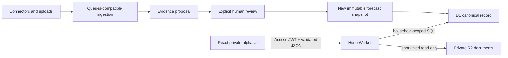

# Architecture overview

Keel's first deployment is a private, single-user alpha, but every canonical
record is household-scoped so the authorization boundary is explicit from day
one.

## Boundaries

- `apps/web` renders validated API output. It has no embedded financial
  fixtures; the Playwright harness exercises locally seeded D1.
- `apps/api` authenticates the Access assertion, adds secure headers, logs only
  redacted request metadata, and invokes household-scoped repositories.
- `packages/database` contains the normalized Drizzle schema, forward D1
  migration, repository, and fabricated seed.
- `packages/domain` owns integer-only financial and projection calculations.
- `packages/evidence` owns evidence validation and one-way review transitions.
- `packages/connectors` defines size-limited documents, queue envelopes, and
  evidence-proposal contracts. Connector-specific folders document the future
  trust boundaries.

## Value semantics

The model intentionally avoids a single overloaded “value” column:

| Concept                   | Meaning                                    | Decision use      |
| ------------------------- | ------------------------------------------ | ----------------- |
| Administrator NAV         | Current administrator-reported value       | Reconciliation    |
| External mark             | Latest observed external economic mark     | Evidence input    |
| FI underwriting           | Conservative policy value                  | FI planning       |
| Thesis-weighted value     | Conditional probability-weighted economics | Scenario analysis |
| Timing-adjusted liquidity | Value discounted for timing/probability    | Forecasting       |
| Actual liquidity          | Distributed cash that actually occurred    | Reconciliation    |

All currency is represented as integer minor units. Probabilities are integer
parts per million. Quantity fields use explicit integer scales.

## Immutability and audit

Forecast snapshots, outputs, company forecasts, liquidity curves, review
decisions, and actual-liquidity events are guarded by D1 triggers against update
or deletion. Accepted marks and accepted evidence cannot be deleted. A new
forecast changes the record by appending a new version.
