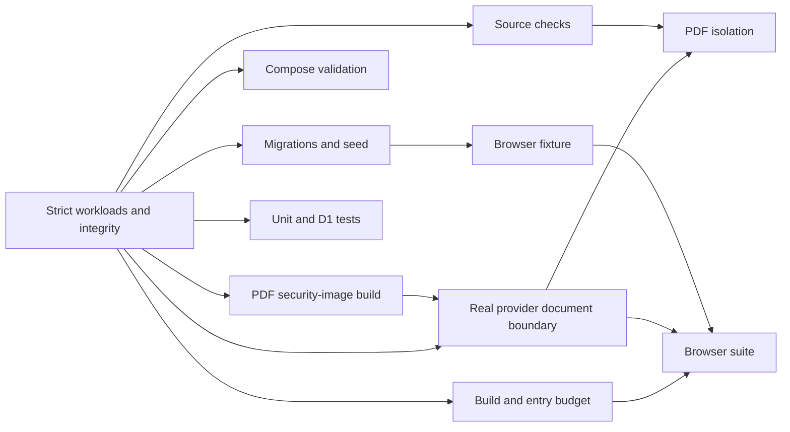

# CI performance contract

The current CI split keeps runtime quota admission in draft PR #340. Earlier
measurements below describe the combined branch at their recorded revisions. Its
quota-owner tests are deferred with that implementation. The current registered
inventory and required receipt define executable coverage for the CI-only
branch.

Each ordinary workflow executes the complete native suite once for its exact
revision. The full requirement map, individual case accounting, expected
platform exclusions, native assertions and no-flaky-success policy remain
authoritative. PR merge candidates and merged commits require separate
execution. Named receipt checks are validation of the native producer, not
independent test runs.

## Baseline and budgets

The September 21 UTC baseline is PR run `35548798219` plus pilot run
`35548798262`: ordinary PR checks took 96.1 minutes elapsed, including a
separate 47.9-minute pilot using the same runner. The pilot's required execution
step took 46.0 minutes; ordinary quality and browser jobs took 26.9 and 19.5
minutes. Dependency setup was approximately 16 seconds per job. These are
observations, not fixed machine benchmarks; compare active execution separately
from waiting.

The complete successful merged run `35645412914` at `fa9db84b` is the baseline
for bounded parallel execution: 2,616.849 seconds active, including 1,168.481
seconds for browsers and 885.347 seconds for unit/D1 tests. PDF isolation took
232.225 seconds and source checks 226.340 seconds. It passed 1,151 unit/D1 cases
and 288 browser cases, with 44 reviewed browser exclusions and no flakes.

`.tugling/pilot.json` enforces a 900-second active native budget. The complete
receipt records elapsed execution time, each flow duration and a sorted timing
summary. Concurrent flow durations are not added to claim wall-clock time.
Exceeding that budget fails required verification without silently dropping
checks. Watchdogs remain independent safety ceilings. Do not raise the budget to
hide a regression.

The complete `browser-workflows` command has a separate **300-second elapsed
budget** in `.tugling/pilot-verification.json`. It includes profile copies,
server/browser startup, all registered cases, report validation and owned
runtime teardown. Queue time and the existing build/seed prerequisite flows
remain separate. The native launcher terminates an overrun. Receipt publication
and every downstream receipt check also compare the measured duration with the
declared limit, so observing an exit-code-zero process just after its deadline
cannot produce a green check. The 900-second whole-gate budget remains.

Keep browser lanes balanced as coverage grows. The carry/share-basis change
added 24 executions to one serial production lane, taking its passing count from
38 to 62. Required browsers grew from 240.149 seconds to 341.573 seconds on that
feature's merge candidate, then 338.356 seconds on `f5b1034a`. Purchase-details,
share-basis and legal-name-resolution specs now move to the other equivalent
production lane. The observed case-body loads predict roughly 237/239 seconds
instead of 312/165. These are scheduling estimates, not a measured CI
improvement. Every case, assertion, snapshot and platform exclusion remains;
each stateful lane still has one worker and the global cap stays four. The
active required gate must establish the resulting Linux timing.

The first required attempt, `42339574169`, reached the new browser deadline and
failed closed. Its 303.050-second duration includes termination and owned
cleanup; remaining cases did not run and no complete receipt was published. The
rebalance alone is insufficient under that run's concurrent load. Host samples
show memory pressure and 2,398.6 MiB of swap in use; sampled process RSS peaks
were 8,242 MiB for browsers, 3,667 MiB for source checks and 2,638 MiB for
unit/D1 work. These peaks are not additive physical-memory measurements.
Browsers now wait for source checks and unit/D1 verification to release their
resources. Their existing work remains required within the same 900-second
native gate, and browser execution still has its 300-second limit.

The same tree, `83cee0ee`, passes the complete canonical Linux browser suite in
208.228 seconds in isolated diagnostic run `42340411992`: all 151 executions and
the same 15 exclusions. This supports removing competing heavy work; the
required gate must still establish both elapsed budgets with the new schedule.

The complete local functional replay on macOS passes all 151 executions and the
same 15 exclusions in 96.717 seconds through the actual 300-second launcher
deadline, including report accounting and cleanup. This isolated run does not
establish canonical Linux pixels or elapsed time under concurrent CI work.
Functional mode accepts the native runner's read-only `--update-snapshots=none`;
actual snapshot-update modes remain rejected.

Use Actions job creation/start/completion timestamps to measure queue and setup
time separately. Compare complete successful workflows at the same coverage; do
not count cancelled or filtered runs as speed improvements. Desired future
service targets are p95 queue under two minutes and p95 PR completion under 15
minutes. These are service targets, not a claim established by one successful
run.

## Capacity and further reductions

One `keel-ci` runner currently serializes verification. Adding YAML jobs alone
does not add capacity. The host also serves other workloads; measure peak CPU,
memory, I/O and queue pressure before adding runners or increasing worker
counts. Keep the credential-bearing deployment account separate.

Run the small release gates before admitting expensive native verification on
this single runner. PR native verification waits for its secret scan; post-merge
native verification waits for both the full-history secret scan and the pinned
Tugling project contract. Preview still depends on all three gates. This
prevents a completed native run from waiting behind another long native job
merely to finish its small release checks. It does not eliminate queueing before
verification or add capacity for simultaneous native runs.

The need was observed in merged run `35771028409`: native verification passed at
19:14:10 UTC, but a Dependabot native job occupied the runner from 19:14:45 to
19:27:47. The contract and secret scan completed only at 19:28:14 and 19:28:27,
so preview finished at 19:30:01. Native execution itself took 698.799 seconds
(11m39s), versus 1,337.720 seconds before this optimization round. Its browser
flow took 425.105 seconds and unit/D1 flow 511.484 seconds; 1,159 unit tests and
288 browser cases passed, with 44 unchanged browser exclusions and no flakes.
The 28m52s end-to-end workflow includes that queue gap and must not be
represented as an 11m39s delivery.

Prioritize the real D1 cost fixtures and browser tests using measured receipt
and native-report timings. Preserve the full-day provider scenarios and real D1
cost assertions. Browser tests that share mutable D1 state remain serial.
API-mocked cases reject unexpected application API calls and own their browser
contexts and fixtures. Stateful partitions use independent D1 directories,
servers, ports and cleanup; each partition remains serial internally.

## Bounded execution plan

The verification map admits an exclusive preflight before any heavy flow. The
existing integrity flow first executes the strict workload and migration files
with one Vitest worker, then runs native Python accounting. The main unit flow
executes the complementary cases. Both reports must account for the entire
reviewed Vitest inventory exactly once. Missing, stale, substituted or
overlapping preflight evidence fails verification.

Source checks, the PDF image build and workspace build now wait for that gate,
along with the flows that already depended on integrity. After preflight, at
most three native flows run concurrently. Admission follows the reviewed map's
first-ready order. The main unit flow has priority over the independent PDF
image build and migration flow, so neither delays its admission. Unit work may
overlap source checks. Browsers wait for both flows to complete, avoiding three
competing heavy phases. PDF isolation waits for source checks, so its scanner
cannot overlap the compiler flow; it may overlap browsers after the unit flow
completes. Source checks still must pass in the same complete receipt.
Configured scanner and compiler limits do not establish observed memory use or
available host capacity. The 900-second active budget and per-case deadlines
remain. Native main units and standalone execution use three workers after the
two-worker trial below failed the complete budget.

Draft PR #340 tried admitting the workspace build before the main unit suite in
[run 41803819700](https://github.com/cyyapye/keel-fi/actions/runs/41803819700).
All 11 flows passed. Compared with the preceding run, the browser suite started
55.640 seconds earlier but took 39.265 seconds longer to execute. The complete
gate fell from 828.915 to 812.540 seconds and missed the 750-second trial
cutoff. The map restores the previous order.

The native source flow uses `make lint-typecheck` to collect full compiler
diagnostics from the TypeScript programs already loaded by typed ESLint. It
retains every active root, workspace and catalogue context, their lint files and
rules, and the zero-warning limit. Standalone `make lint` and `make typecheck`
remain available. The historical
[carry proposal](../../e2e/carry-proposal/README.md) has opt-in replay checks;
its compiler context and dummy fixture are retired from ordinary CI now that the
shipped feature has domain, API, D1 and browser coverage. The public-data scan
and formatting checks still include the archive. The combined command validates
canonical context discovery, configuration syntax, CLI options, complete roots
and supported source types. Missing contexts and unsupported compiler modes fail
rather than silently reducing coverage. Alternative parsers and processors are
refused because transformed input can hide diagnostics from the original source.
It creates no persistent cache or receipt.

Its regression fixtures reuse loaded modules in an owned child while each
operation clears parser caches and creates fresh context maps. The strict CLI is
checked separately. The existing per-fixture timeout and aggregate output bound
still apply, including rejection of a result received after its deadline.
Same-path source/configuration changes verify that batching cannot accept a
stale compiler result. The child closes between logical cases and before CLI
smokes.

Normal run `41600540573` spent 269.761 seconds in source checks and admitted
wide phases at offset 351.88. It failed a browser case that passed on retry at
893.586 active seconds, before the 900-second boundary. Remaining unit and
browser work was interrupted. A private five-pair macOS prototype comparison
found less compiler CPU work, no elapsed improvement and higher reported child
peak RSS. That experiment justifies testing reuse on Linux; it does not
establish whole-run headroom.

The next ordinary attempt, `41612724486`, spent 222.061 seconds in source checks
but failed a different retry-success case at 843.066 active seconds. Main unit
work and the final browser lane remained incomplete. Removing source-check
serialization is an experiment alongside work reductions, not a forecast. The
bounded resource summary now distinguishes weighted host execution, steal,
iowait and idle from the existing raw tick samples. Its legacy busy peak
includes steal. These are host-wide observations; flow CPU remains a sampled
lower bound.

The same samples also expose host logical CPU count, total memory and total swap
from their existing buffers. Per-flow resident memory is a peak of sums of
observed process RSS. Shared pages can be counted more than once, and containers
outside the owned process tree are excluded. This is not aggregate physical
memory or an effective CPU quota. Sampling frequency, target paths and read
bounds remain unchanged. One page-size query per sampler converts resident pages
to bytes without assuming a host page size.

Run `41627807001` passes all eleven flows, 1,648 unit cases, 426 browser cases
with 32 existing exclusions and 49 Python cases at 861.783 active seconds. Its
38.217-second margin is insufficient practical headroom. Browser work is
critical at 605.639 seconds; main units take 693.996 seconds and source checks
408.303 seconds. Host samples show memory and I/O pressure, but do not attribute
that pressure to a particular flow.

The native-main-only two-worker trial, run `41635613228`, fails the global
budget at 903.027 active seconds. All browser cases and 49 Python cases pass,
but main unit work is interrupted after 797.248 seconds and the complete unit
union is not established. Source checks take 372.072 seconds and browser work
578.553 seconds. These are different attempts, not an isolated causal
comparison. Restore three native main workers and retain the proven duplicate
browser-read removal. The exclusive one-worker preflight, native-flow and
browser ceilings, complete inventory, assertions and all deadlines remain.

Run `41641925007` fails within budget at 835.421 seconds when the exposure
continuity migration case exceeds its unchanged five-second deadline. The other
1,647 unit cases and all 49 Python cases pass; browser work is interrupted. The
next partition moves the complete 28-case exposure file into the existing
one-worker preflight. All its cases use in-process SQLite and repositories. The
cold migration body, frontier and deadline remain. Preflight now accounts for 84
unit cases and main for 1,564, with the same complete 1,648-case union. The
gate's 120-second budget remains and needs actual Linux acceptance.

Three ordinary SQLite fixture helpers also reuse the existing content-keyed
snapshot helper. Five alternating local pairs pass all 590 selected case
executions. Median wall time falls from 6.510 to 1.267 seconds and reported
child CPU from 13.389 to 3.730 seconds; largest reported child peak RSS
increases slightly and is not aggregate memory. These are Darwin component
measurements, not a full Linux result. Explicit migration frontiers and all 59
cases, 235 assertions, adapters, ordered inputs and per-case business SQL
remain.

Four further ordinary setup prefixes reuse that same helper. Five local pairs
preserve all 280 executions in the selected five-file subset, including the
unchanged one-use API fixture. Median wall time is 2.048 to 1.498 seconds and
reported child CPU is 6.445 to 4.020 seconds. Exact state, foreign keys,
rollback and clone cleanup remain; this establishes no full-run speedup.

The PDF-priority trial in run `41658444196` fails the global budget at 900.513
seconds. All 1,648 unit cases and 49 Python cases pass, but browser work is
interrupted after 383 successful pass lines. Source checks take 292.011 seconds
and main units 609.437 seconds; browsers start at 383.035 seconds. These
different attempts do not isolate a causal speedup. Reject that map order and
restore the source-before-PDF dependency and prior browser priority. Retain the
ordinary fixture improvements. All 11 flows, deadlines, case coverage and
concurrency ceilings remain required.

The restored policy in run `41663108413` also fails the global budget, at
901.127 seconds. All 1,648 unit cases and 49 Python cases pass; browsers stop
after 413 successful pass lines, including 23 of the final 36-case tail. This is
not a complete passing receipt or a fast-run result.

The manual visual fixture separates route registration from opening the creation
editor. Six existing-holding or inventory journeys avoid the unused creation
visit. The complete private paired file retains all 32 identities and observed
states, 24 mutations and 16 reloads. It records 12 fewer document navigations,
12 fewer Holdings projection GETs and 24 fewer options GETs. These are counted
requests, including canceled reads, rather than elapsed savings. The
stale-identity and single-company Fund preludes remain: removing the Fund
prelude let a draft-key collision pass. Seven paired fault families retain their
rejection boundaries. Named screenshots use separate private Darwin references;
all 22 Linux PNGs remain unchanged. Extra diagnostic captures initially match 29
of 32 pairs; six bounded settled follow-up pairs match. This component proof
does not establish complete Linux fit or useful headroom.

Run `41670925141` fails within budget at 811.453 seconds. All 1,648 units, 49
Python cases and the 32 manual visual identities pass; the latter have zero
retries and match the exact published tree. A purchase-history case misses its
unchanged five-second Edit valuation assertion, then passes on retry. Native
accounting rejects that flaky result and cancels the other browser roots. The
364 successful browser pass lines do not form a complete receipt.

Purchase visuals previously mocked financial mutations while an accepted
valuation also waited for live Alpha data from unrelated test-database state.
The fixture now uses the existing fail-closed API guard and explicit background
responses. The Alpha initializer and three contexts move unchanged from the
holding-detail spec into a shared browser fixture. Small background response
initializers reuse existing synthetic values. All original callback bodies,
financial routes, assertions, project settings and deadlines remain.

A controlled HTTP pair passes 30 purchase and two holding-detail cases on each
side. Browser Alpha calls remain 34; owned Alpha HTTP visits fall from 26 to
zero and all owned backend visits from 34 to zero. One candidate holding-detail
case makes one additional already-mocked review GET with the same body and no
backend visit. Request-count parity is not universal. Mock valuation
fulfillments remain 16 per side; only 14 responses are browser-observed after an
original immediate reload, so receipt delivery is not inferred from fixture
acceptance. Subsequent projection and history readback remain separate proof.

An eight-second Alpha response reproduces the old five-second failure in both
projects; isolated cases pass. Failed valuation, stale projection, empty history
and absent exposure controls still reject. All 32 settled states and final
camera pairs match; original crop assertions and Linux PNGs remain unchanged.
These are private Darwin and controlled HTTP results, not real-D1 parity,
complete Linux acceptance or elapsed savings. Production still awaits Alpha;
this test change does not fix or certify that latency behavior, and the exact CI
failure cause remains unproven without its unavailable trace.

The standalone provider-document boundary runs real Chromium through the
production tsx entrypoint, scanner and reader after image provisioning and
integrity. It retains the former browser wrapper's 50-second child timeout, 128
KiB output bound and exact counts/name/page assertions. Both the UI suite and
the remaining PDF isolation probes depend on this boundary. This prevents a
fifth browser worker and concurrent PDF callers while allowing CPU-light kernel
watchdogs to overlap UI work. The full PDF suite remains mandatory for success.
The UI suite also waits for the sealed fixture and build. Formatting and linting
exclude ignored runtime/fixture/cache directories; repository sources and tests
remain in scope.

The declared prerequisites are:



Only three ready flows execute at once; an arrow means the prerequisite must
finish successfully. Source checks use at most two Make jobs, and PDF proof uses
one independently limited container per daemon across processes. Kernel
ownership serializes the scanner/reader and adversarial sequences through
confirmed cleanup; all original probes remain required. The fixture uses a slot
released by an earlier flow and can overlap remaining source/PDF work. No UI
browser consumer starts before its fixture, real provider document boundary and
build succeed. All PDF isolation probes must pass before the gate succeeds.

The populated migration fixture hashes every selected row beside real D1 and
returns each table's row count and SHA-256 digest. This avoids transporting
large preservation results through the Node binding proxy. The host compares all
table digests with the independent OLD-schema snapshot. SQL, schema and
foreign-key checks, immutable probes and actual migration billing counters
remain required. PR340 run `41518998047` rejected serial source checks at the
unchanged 600-second flow deadline. Source goals retain their prior two-job
limit. That failed attempt also exceeded the historical 24-capture case's
unchanged 120-second deadline; the revised driver requires a fresh complete
native receipt.

The historical comparison prepares one closed real-D1 OLD-schema seed inside its
timed case. Both branches receive fresh verified copies. The seal binds the
exact bootstrap SQL, runtime configuration, lockfile and pristine platform
schema. Existing 64 MiB and 32-file bounds remain. Complete preservation still
precedes measurement on each copy. This removes a duplicate unmeasured bootstrap
without moving setup outside the unchanged 120-second deadline. Run
`41522276828` retained one failure at that deadline before this seed trial; all
other 1,645 unit cases and the complete browser inventory passed. A fresh
complete native receipt must establish this candidate's Linux fit.

Standalone and native main-unit execution use three workers. Preflight uses one.
Priority alone did not isolate the strict CPU workloads: run `41587011543` timed
out both the runtime graph and capacity day before browser startup while
source/migration work was active. The explicit gate supersedes priority-only
admission for those two files. Cash-account, purchase-route and provider-usage
files also run in the one-worker preflight. The purchase-route case previously
exceeded its unchanged five-second deadline during browser overlap in run
`41383958842`. Its authentication, validation, accepted-write, valuation,
history and fixture work remain inside that same test and deadline. The two D1
cost files remain in main, which can run alongside source checks and browsers.
Main unit files retain their measured cost priorities. Run `42772244012`,
attempt 2, exposed a 104.9-second cash-history fixture: it started at offset
483.12 of main Vitest and finished at 588.04, while every other file finished by
535.98. Early admission then exceeded the unchanged 120-second case deadline in
run `42777326654`. Its setup now executes the same production bank-refresh and
holding-import operations beside D1, following the existing rename fixture
pattern. The host still meters every original history read and checks its query
plans. All 100 bank accounts, 120 brokerage positions, historical growth,
foreign-household checks, assertions and deadlines remain. A managed Linux
replay completed the file in 11.1 seconds (case body 5.7 seconds), with exactly
the original counters: bank reads 3,206/6,406 and brokerage reads 11/20, zero
writes, and three/two read-model round trips respectively. This focused replay
supplies a 12-second scheduling hint, not a whole-gate headroom claim.

Cost fixtures without a timing hint receive early admission for both
`-cost.test.ts` and `-d1-cost.test.ts` names. These priorities retain every
discovered specification and worker count. The failed complete run also started
main units at offset 113.423 after the image build, despite units having only
the completed integrity gate as a prerequisite. Admitting units before those
independent flows removes that avoidable wait; a new full Linux receipt must
establish the resulting gate duration.

The automatic-review day/history case has early main-phase priority after run
`40443347834` exceeded its unchanged 90-second deadline during browser overlap.
That run's host CPU pressure (`some avg10`) had a 65.6% median. Those admission
changes retained its 120-item histories, request envelope, D1 assertions, worker
pool and timeout. The two-worker native trial was rejected above. A complete
Linux run remains the acceptance check. The reviewed-rename cost fixture runs
its synthetic import and 240 company-review operations inside its existing
workerd fixture to avoid repeated Node-to-D1 bridge calls. It uses the same
repository methods, accepted decisions and link records. The test still meters
every positive, history, empty and unrelated-household read against real D1,
with the same 120-position scale, row budgets and query-plan assertions.

Browser verification produces six reports with at most four active workers.
Three stateful partitions and one mocked partition start together. The first
mocked partition releases its slot to the isolated production source-update
partition. The development stateful partition releases its slot to the remaining
mocked holdings and agreement-security checks. This separates the real source
fixture from the longer general production partition while retaining every case
and the complete 300-second deadline. At most four stateful API processes can
overlap; neither mocked partition starts an API. The other partitions can finish
independently.

A November 8 Linux x64 canonical replay accounted for all 178 cases: 163 passed,
15 existing exclusions, zero unexpected or flaky results. Its merged browser
span was 276.477 seconds and the enclosing 300-second command passed. Across 140
two-second host samples, available memory stayed above 4,033 MiB of 11,676 MiB.
This standalone browser trial is separate from the complete exact-revision CI
gate and is not an isolated causal comparison.

The checked-in case inventory defines the required executions and explicit
exclusions on each platform. Each retired case and its remaining coverage are
recorded in [test performance coverage](test-performance-coverage.md).

The manual-holding visual tests and UI catalogue use the fail-closed API-mocked
fixture inside production stateful-a. API mocking belongs to each test's
fixture, independently of its lane's server. The fixture blocks service workers
and rejects unhandled API reads and writes. Each stateful partition receives a
separate copy of the verified, closed synthetic seed and owns distinct API/web
ports. Neither mocked lane starts an API server. The legal-entity suite uses the
built frontend and bundles the actual collection search module for its browser
timing check. The development stateful lane owns the recovery, navigation and
Watch development behavior. Its provider cases use controlled browser profiles
or provider pages, and the reconnect interstitial still reaches the local API.
Missing production JS or CSS fails startup. Each retained visual comparison uses
its existing platform reference. Each lane owns its dependency cache and output.
Development readiness validates the initial module graph; stateful readiness
also checks the actual holdings projection through the web proxy. A simpler
health endpoint cannot hide a cold first read.

The migration flow runs every migration and the base synthetic seed, then copies
its closed D1 tree into a dedicated allowlisted browser path before applying
default-scenario additions and checking all canonical invariants. It verifies
the browser binding/readback and seals both source inputs and complete fixture
contents. The required browser command only accepts that seal, clones four
profiles and consumes the seed; it never falls back to a reset on the browser
critical path. The standalone `pilot_native.py playwright` command retains its
reset-and-verify behavior and uses a separate seed path. All commands share the
Playwright lease while touching browser runtime/report paths.

Stateful Wrangler instances use OS-assigned inspector ports so debugger
listeners cannot collide even though application ports are distinct.

The image build is an explicit required flow, with its failure, timing and
cancellation included in the exact-revision receipt and 900-second budget. Daily
`SECURITY_REFRESH_DATE` package refresh, freshclam signature refresh,
rootless-engine validation, immutable digests, atomic configuration writes and
the clean-scanner preflight remain unchanged. No consumer uses partially built
images. Native and manual pilot workflows do not build the images a second time
outside the dependency graph.

## Test layers and coverage preservation

Policy permutations belong in unit or integration tests that call production
code. Browser tests own browser behavior; real PDF tests own the executable and
kernel boundary. `.tugling/test-layering.json` maps the migration from
`1ee7afcc` to exact replacement and retained boundary case identities. Its
native test rejects a missing or excluded replacement or browser boundary. The
complete case inventory still rejects filtering, omissions, retries and flaky
success.

The migration retains all prior unit/D1 cases and all visual baselines. It moves
agreement scan/cache/recheck/budget permutations to the production capture core;
renewal diagnostics to the real event observer with synthetic Request/Response
boundaries; and expiry rules to the same storage reader and decision function
used by the worker. Provider DOM tests use registered synthetic PDF text, while
the production `tsx` capture still uses real Chromium, scanning and extraction.
Production factories retain their real scanner/reader defaults.

Other moved matrices cover investment-link identity, ambiguity and survivor
selection; timezone/DST formatting using real Node Intl; Google SDK outcomes;
120/1,000-item search; ownership percentages; and agreement page bounds. Shared
synthetic domain constructors keep the old and replacement inputs aligned.
Browser tests retain form binding, unsaved choices, rejected drafts, reload,
history, local timezone display, SDK callback wiring and search DOM/read limits.
The 1,000-item browser search keeps its real-browser p95 limit of 50 ms.

`.tugling/test-layering-proof.json` records paired negative controls. Six
document defects, four renewal defects and three investment-link defects were
rejected by both the original browser tests and their replacements. An
additional HTTP-classification defect was caught only by the replacement: the
old browser fixture's sign-in fallback masked it. These controls demonstrate
retained fault detection for the changed rules; they are not a universal
equivalence proof. Exact-revision complete native verification remains the
release requirement.

The remaining browser files were reviewed by boundary:

| Boundary                       | Retained checks                                                                                                                                                                               |
| ------------------------------ | --------------------------------------------------------------------------------------------------------------------------------------------------------------------------------------------- |
| Navigation and loading         | Entry-script failure, deferred modules, router/history, keyboard focus, lazy rendering and script/style loss.                                                                                 |
| Holdings and collection search | Responsive grouping, hidden cash, progressive rendering, highlights, 1,000-item DOM limits, browser performance and one projection read.                                                      |
| Review and legal entities      | Distinct visual states, form bindings, manual decisions, independent saves, rejected drafts, exact reload/readback, downloads and SDK script integration.                                     |
| Planning, goals and cash flow  | UI-triggered refreshes, linked goal navigation, confirmation boundaries, save/readback and responsive summaries. Public/private/cash refresh scenarios retain their separate component paths. |
| Portfolio Watch                | Async loading/error/recovery, source disclosure, review actions, history, evidence navigation and distinct visual states.                                                                     |
| Provider agents                | Delayed DOM readiness, count reconciliation, drawers, exact source association, URL routing, popup ownership, real process shutdown, persisted profiles and cold restarts.                    |
| Reconnect and sessions         | Actual access/tunnel/viewer behavior, token rotation across process restarts, the simulated full day, request admission and browser storage serialization.                                    |

The mandatory PDF suite retains real clean and complex PDF extraction, malware
and archive/stream limits, filesystem/network/process isolation, unsafe-kernel
handshake rejection, killed-caller cleanup, orphan reaping and absence of
retained containers. Mocking these would weaken validation. Runtime
timer/network inventory changes only the owning function name for the unchanged
document fetch; its call digest, schedules and admission limits remain
unchanged. The reader watchdog tightening described below is the sole deadline
change.

For performance comparison, use the complete successful PR323 merged run
`39872116335` at `1ee7afcc`: 661.445 seconds active, including 376.629 seconds
for browser workflows and 247.068 seconds for PDF isolation. It passed 1,282
Linux unit/D1 cases and 351 executable browser cases with 45 reviewed browser
exclusions. Compare new complete receipts on the same runner against this
baseline, using the migration map to account for changed layer membership;
focused local timings are not a full-CI benchmark.

The September 23 UTC cold refresh in run `35800328085` took 120 seconds before
the native gate: approximately 56 seconds for the reader/base and 63 seconds for
the scanner, with a cached probe. Using the measured flow durations and
three-slot schedule, moving that build into the graph projects approximately 92
seconds (11%) saved on this cold path. Warm builds around 25 seconds offer about
3% savings. This is a scheduling projection, not a measured cold run of the new
graph; source/build contention can change the result. Preserve daily security
freshness rather than skipping refreshes to meet the budget.

CI uses `make bootstrap-ci` for the toolchain, locked dependencies and Chromium.
The required migration flow owns the default database reset and readback. The
developer `make bootstrap` still seeds a ready-to-use local database. Removing
the duplicate CI reset does not remove the migration or seed verification.

New or unclassified specs fail partition validation. All six reports must
individually match their partition and jointly match the complete reviewed
inventory; one green lane cannot substitute for the suite. Merged elapsed time
is the span of the concurrent lanes, not their summed work. Per-suite leases
reject duplicate writers, and cancellation cleans owned process groups before
removing the isolated database profiles. The reviewed dependency map is exact:
each delayed lane waits for its designated predecessor to validate its report
and release its process group and port. The source lane follows the first mocked
lane; the second mocked lane follows the development stateful lane. All six
lanes run within the timed phase, with at most four active browser workers.

The initial OVH capacity inspection found six CPUs, 11.4 GiB RAM, approximately
9.3 GiB available memory and low CPU/I/O pressure. This is a starting snapshot,
not peak-load proof. Measure pressure during complete concurrent runs before
raising either concurrency limit. One native runner job still owns all work; no
additional persistent runner or deployment credential access is introduced.

Failure, timeout, cancellation, missing cases, duplicate cases and flaky retry
success remain failures. The scheduler stops admitting dependent work after a
failure and cleans up only process groups it owns. Exact project, map, helper,
environment, run and attempt binding remains mandatory for receipt consumers.

Validation includes real scheduler dependency/overlap and cleanup holdouts,
browser partition and unexpected-API rejection checks, same-suite lock
contention across processes, swapped-lane/worker-count rejection and
missing/duplicate lane report rejection. The browser guard is exercised through
real Chromium: a known synthetic GET succeeds, while an unknown GET and an
unexpected POST to a read-only fixture fail. Delivery requires a complete
successful exact-revision PR gate, merged-revision gate and protected preview
smokes. A faster filtered or failed run is not a performance result.

## Test layers

Use unit tests for pure scheduling and decision rules, fast SQLite integration
for SQL-backed behavior, and real D1 for billing counters, index maintenance,
migration compatibility and scale holdouts. SQLite changed-row counts cannot
stand in for D1 billed writes. Keep browser coverage for actual user workflows
and Worker runtime boundaries, without repeating every decision permutation.

Provider document browser cases retain real DOM, popups, source association,
downloads and page restoration. Scan/cache/backfill policy matrices execute
against the production capture core with explicit scan/extraction boundaries.
The standalone production tsx integration retains real Chromium, scanning and
extraction; the dedicated PDF suite retains every adversarial scanner and
isolation probe.

The provider full-day gate runs all five scenarios through the production
client, web proxy, API, authentication and repositories using in-memory SQLite.
It records every SQL operation, binding, result and atomic batch, then replays
the complete trace inside workerd. Every D1 result must match. The original
HTTP, Worker invocation, round-trip and actual D1 billing ceilings still apply;
no averages, sampled requests or shorter virtual days replace them. The replay
fixture rejects unsupported metadata-dependent behavior rather than supplying
fake D1 billing metadata. The cash-request fixture may consume mutation
`meta.changes` only: each consumed value is recorded and independently compared
with real D1 during replay, including trigger effects. Reads of billing metadata
or metadata reflection fail closed. Required browser tests continue to cover
Worker HTTP behavior.

Session setup and browser reconnect checks use the same complete-trace proof.
Each test retains its shared application and trace state across scenarios. Each
measurement checkpoint replays the accumulated trace into a fresh D1 database,
excluding prior setup and scenarios from that checkpoint's billed region. This
preserves state transitions without applying a write twice to one replay target.
Every scenario still checks its full request count and actual D1 billing.

The collection read-budget fixture meters both production capture passes beside
D1 and returns their actual counters, query diagnostics and continuity count for
the original assertions. Only the remaining proposal, Watch, connection and
unrelated-household setup is unmeasured. All eight read, discovery, race and
history cases retain their original request paths, ceilings and watchdogs.

`scripts/sql-replay.test.ts` checks result divergence, missing operations,
missing metadata, transaction rollback, setup exclusion and real index-write
billing. A negative-control experiment restoring one-minute heartbeat writes
rejected 8,637 billed writes against the unchanged 2,000-write ceiling. The
fixed idle day reads 77,165 rows and writes 1,725, matching the previous harness
exactly. All five scenarios retained their previous measured billing totals.

On the same local macOS checkout, the old idle case took 33.6 seconds and replay
took 13.3 seconds. The complete five-scenario replay suite took 57.4 seconds.
These local measurements do not establish OVH timings or the 15-minute target.
Use the native timing receipt and Vitest artifact for the eventual OVH
comparison.

The private-continuity D1 holdout runs its unmeasured synthetic setup inside the
same workerd database: initial legacy holdings, three complete same-date history
imports and an unrelated household. This avoids repeated cross-process setup
transport while retaining the production import repositories, all 120 items and
real database constraints. The measured import, reconciliation, retry, read and
query-plan assertions still use actual D1 metadata. Its 90-second watchdog and
all billing ceilings remain unchanged.

The same boundary applies to holdings, Portfolio Watch, automatic-investment,
participation, company-identity and investment-event fixtures: only unmeasured
setup moves beside D1. Production repositories, real review transitions,
append-only history, unrelated households and database constraints remain.
Measured client/API requests still run through their original path.

The purchase-history holdout runs all 960 production accepts beside D1,
resetting the real meter for each operation. It returns all 960 billing records
and all eight history-read records for the unchanged per-operation assertions.
Ordered position/version accounting and a 960-receipt database readback reject
partial execution; household isolation and query-plan checks remain on the host.
No write transactions are combined and no billing values are synthesized.

The source-capture write-budget holdout also executes beside D1, with its meter
covering every setup, capture and automatic-review operation. It retains all 120
investments, 24 captured documents, 96 exceptions and the combined 8,000-write
ceiling. The source/capture/review measurement boundaries remain unchanged; only
the host transport is removed.

The 120-position baseline holdout retains one actual review transition and
directly seeds the other 118 historical reviews using schema-validated states
and normal database triggers. All history, unrelated-household, retained
exception, query-plan and read/write ceilings remain. Review workflow and
stale-evidence behavior remain covered by their dedicated integration tests.

## Failure and recovery

Preview release run `41014840234` failed twice on the unchanged 90-match private
provider continuity migration fixture's five-second deadline. The storage-only
protected check had already passed; neither attempt reached D1 export,
migrations or deployment. Both bounded failure bundles were preserved.

That fresh in-memory fixture now reuses prepared statements, following the cash
fixture's existing pattern. All SQL executions, bound values, constraints and
read-model round trips remain. It still seeds 180 positions across three
providers, executes the actual migration twice, checks 90 exact continuities and
180 retained snapshots, and runs foreign-key/integrity checks. Cached reads must
observe the real schema change; the existing before/after assertions prove that
behavior. No test identity, timeout, retry, exclusion, worker count or complete
gate budget changes. A focused macOS run measured 360.681 ms before and 296.190
ms after; all 28 exposure tests pass. These are local measurements, not a Linux
headroom or complete-CI speedup claim. Exact-revision Linux verification remains
required before release.

PR run `39363608558` exhausted the unchanged 900-second gate with unit and
browser work incomplete. Unit work started at 138.7 seconds after waiting for
PDF images; PDF isolation waited for a slot until 195.2 seconds and finished at
464.2 seconds, although the build and browser fixture were ready by 269.3
seconds. That attempt led to removing the unit image dependency and prioritizing
ready PDF isolation within the existing three-flow cap. The later test-layering
and independent-build work below supersedes that admission order: real provider
document verification precedes UI and remaining PDF probes. The current map
preserves all required boundaries and the unchanged gate budget.

These observed admission delays are not guaranteed wall-time savings: moving
work changes contention on the shared host. A complete exact-revision Linux
receipt must still finish within 900 seconds. Record active duration, remaining
headroom, all flow timings, native case accounting and resource pressure. One
successful run establishes that attempt, not a recurrence guarantee; robustness
needs matched coverage under representative host load and the daily image
security refresh. Preserve earlier failed attempts when comparing results.

PR run `37951901830` exposed contention across independent native and browser
fixtures: one attempt timed out an unchanged cash cost case at 60 seconds; the
next timed out an unchanged cash integration case at five seconds and a browser
waiting for its initial portfolio read at 30 seconds. Host samples around the
second failures averaged 90.1% CPU busy with CPU pressure reaching 66.19%.
Reducing Vitest to two workers removed those failures in run `37960063713`: all
328 browser cases passed, but the complete gate exhausted its 900-second budget
with unit work still unfinished. Admit the unit flow immediately after its real
integrity and image prerequisites, before migration and browser preparation, and
start the costly native fixtures earlier. The later two-worker schedule retains
this early admission and the measured priorities. Keep all cases, assertions,
watchdogs, retries and the 900-second complete-gate budget unchanged. These
failed runs diagnose scheduling and contention; they do not prove the revised
schedule's readiness or performance. Only a complete exact-revision receipt can
establish that.

Run `37963326704` completed 1,259 unit cases but timed out the remaining rename
scale fixture at 300 seconds. It started late, during browser execution; host
samples during it averaged 90.3% CPU busy with pressure reaching 73.74%. That
fixture lacked a scheduling hint despite its completed 200-second execution in
run `37951901830`. Include that observed duration in the existing longest-first
sequencer so the fixture starts in the early native pool. Its 120-position
scale, historical and foreign-household cases, D1 limits and watchdog remain
unchanged.

Run `37965665802` completed the rename fixture in 246.8 seconds after scheduling
it early. Its remaining unit failure was a five-second runtime-inventory
watchdog during browser overlap; nearby samples averaged 94.4% CPU busy. Restore
two unit workers while retaining early admission and the measured priorities.
The prior two-worker budget failure started native work 153.8 seconds later and
had not yet included the rename timing hint. Full unchanged membership and a
complete successful receipt remain the acceptance criteria for this schedule.

Native CI uses loopback web ports 31031–31035 and API ports 32032, 32033 and
32035, outside local development ranges and OVH's Linux ephemeral range
(32768-60999). A preflight checks port availability and the live kernel range
before expensive verification. This avoids automatic outbound-port allocation
colliding with browser startup after the unit suite; it does not reserve ports
against unrelated explicit listeners. The browser server still fails closed on a
later conflict and never reuses another server. Keep one native job per
dedicated runner and do not kill an unknown port owner.

Receipt consumers require the producer's success, the exact artifact name from
the current run, and matching project/config/map/helper/environment/run/attempt
identities. Missing, failed, partial, expired or stale evidence fails closed.
Rerun the entire workflow: rerunning only a consumer in a new attempt correctly
rejects evidence from the previous attempt. Receipt artifacts expire after seven
days; learning ledgers and provider data are never uploaded.

Receipt jobs skip cancelled workflows so obsolete runs release their concurrency
slot instead of waiting for the shared runner. A failed native producer still
runs the receipt jobs, which reject its unsuccessful result before downloading.

The manual candidate workflow retains the synthetic polling-regression rejection
experiment. Post-merge native verification, secret scanning, pinned released
adapter validation, protected backup/migration/deployment and smoke checks
remain required before claiming preview delivery.

## September 22 optimization experiment

The next measured round targets the complete native gate, using merged run
`35690710837` (1,337.720 seconds) as its baseline. Browser elapsed time was
959.120 seconds; unit/D1 elapsed time was 1,056.354 seconds. Both branches must
improve because their completion times differ by only 55 seconds.

The experiment preserves every reviewed case, desktop/mobile variant, real D1
billing assertion, migration boundary, failure outcome, and exact-revision
receipt. It changes only test transport, unmeasured fixture initialization and
scheduling. Each accepted optimization must pass focused integrity tests and the
complete OVH gate; timing from a failed or filtered run is diagnostic only.

Execution slices:

1. Profile provider initialization, scenario execution and D1 replay separately.
   Batch only consecutive standalone SELECTs during synthetic replay, keeping
   all results and actual rows-read/write metadata. Preserve original production
   round-trip accounting independently of replay transport calls. Never combine
   writes, existing transactions or setup/measurement boundaries.
2. Move repeated unmeasured D1 initialization and scale-fixture setup beside the
   database, keeping a fresh database per test and all measured operations.
3. Run three independently seeded stateful browser partitions and separate
   production/development mocked partitions with distinct ports, runtime state,
   diagnostics and owned cleanup. Compare their complete union with the
   unchanged reviewed browser inventory.
4. Run read-only source goals with at most two Make jobs. Permit three native
   flows so PDF isolation can overlap migration verification. Build and consumer
   prerequisites remain explicit; runtime and migration outputs are not shared.
5. Keep scanner/reader and kernel-probe sequences independent, but serialize
   actual containers through one cross-process daemon owner with unchanged
   limits. Prove caller death and racing real readers without retries. Wait for
   both branches and confirmed cleanup before checking for leftovers.
6. Start the historically expensive Vitest files first, preserving discovered
   specifications and test order within each file. This avoids a large final
   fixture leaving the other workers idle.
7. Inspect the resulting critical path and host resource pressure. Pursue
   another candidate when its credible complete-gate improvement exceeds 5%;
   validate promising scheduling choices with a complete same-host comparison.

The stopping report must distinguish measured savings, rejected experiments, and
untested architectural opportunities. A finite benchmark cannot prove that no
possible future optimization exceeds 5%. No additional runner, larger host,
removed assertion, relaxed watchdog or increased retry count is assumed.

The native job owns one read-only resource observer during verification. It
retains the five-second cadence, at most 361 samples and the independent
30-minute deadline. Host CPU, memory, swap and pressure fields retain their
existing meanings. The job stops and reaps the observer on success or failure;
observer errors do not trigger retries or application requests. It performs no
network, D1 or object-storage work. Diagnostics share the existing seven-day
artifact retention and contain no process arguments, credentials or portfolio
data.

`flow_resources` adds CPU and main-thread run-queue delay deltas for each mapped
native flow. Ownership requires the observer's original parent PID/start time, a
descendant of the expected pinned pilot coordinator, an exact mapped command, a
matching checkout directory, and a new flow session. Descendants are followed
through ancestry even when they start another session. CPU includes each
observed process's threads; scheduling delay covers only its main thread and
requires the kernel's `sched_schedstats` flag to be enabled. Disabled or
unreadable scheduler statistics produce `null`, without changing host settings.

These are sampled lower bounds, not whole-flow totals or elapsed time. Only
matching PID/start-time and flow-root identities in adjacent samples contribute
deltas. New processes, lost processes, counter resets, contributing-process
counts, read errors and discovery/tracking limits are explicit. No matching
counter pair produces `null`; a valid unchanged pair produces zero. Short-lived
processes between samples, startup/exit tails, inaccessible or reparented
processes, other users and work delegated to an existing daemon or a container
may be absent. Missing ancestors and identity changes are excluded. If a flow
has partial coverage, its numeric delta still covers only the reported
contributing processes. Use the complete native receipt to establish which flows
ran; an unobserved flow is not evidence of zero work.

Discovery examines at most 8,192 `/proc` directory entries and 2,048 PIDs per
sample, with at most 32 ancestry steps and 512 tracked processes. The mapping is
read once with a 128-KiB/32-flow bound; command, process-stat and scheduler-stat
reads are capped at 8,192, 4,096 and 128 bytes. No per-thread scan or
environment read is performed. The worst case is bounded by 2,048 process-stat
reads, 4,096 command reads, 2,048 cwd lookups, 512 counter/identity pairs and
6,144 root-chain identity reads per sample; early ownership checks ordinarily
make these much smaller. Output includes collection CPU/wall time and monotonic
sample intervals. These collection timings exclude JSON output and startup, so
observer overhead must also be measured externally. Regression fixtures cover
120 descendants, PID reuse, ancestry boundaries, incomplete reads, bounds and
counter resets. The sampler does not change flow scheduling, assertions, worker
counts, isolation, resource limits or the 900-second native verification budget.

## Evaluated remaining source-check optimizations

An unchanged two-job local source run took 50.19 seconds: lint took 48.47
seconds and typecheck 29.69 seconds. Repeating it with ESLint's supported
`--concurrency 2`, without caching or selection changes, took 54.27 seconds:
lint stayed at 48.41 seconds while typecheck rose to 40.75 seconds. Separate
ESLint workers duplicate their TypeScript project services and increased CPU
work. Keep lint concurrency disabled.

The lint command gives its single Node process a 4 GiB old-space ceiling. PR run
`37834913601` exhausted Node 22's default 2 GiB heap while the runner still had
at least 5 GiB available throughout the sampled gate. Apply this limit only to
ESLint, whose type-aware project services retain the workspace type graph; do
not increase every concurrent Node process's allowance. Full file selection,
type-aware rules and zero-warning enforcement remain unchanged.

OVH run `35764220712` is diagnostic evidence, not a successful-gate benchmark:
source checks took 167.974 seconds, with typecheck finishing approximately 28
seconds before lint. A TypeScript-only cache cannot advance that source
boundary, and even zero-time lint cannot remove the remaining typecheck work.
Ordinary per-file lint caching is unsafe for type-aware rules when imported
types change. Keep the full checks; removing repeated parsing would require a
separately measured design that preserves every workspace's type environment.

## October 22 fixture and critical-path optimization

PR #323 exhausted the unchanged 900-second budget twice (900.884 and 900.459
seconds). Both full attempts left unit work incomplete, with browser work
cancelled at the deadline. These are failed baselines, not accepted benchmarks.
The repeated results rule out relying on another unchanged retry.

The SQLite behavior fixtures now build an immutable, process-local snapshot once
per ordered migration/seed content digest. Every case opens its own database
copy and removes its owned temporary directory on close. No mutable database,
transaction, connection, application state or test outcome is shared. Changed
input bytes or order invalidate the snapshot; a failed migration cannot populate
it. Disposable memory journals retain rollback, triggers, foreign keys and
unique constraints without adding disk durability absent from the old in-memory
fixtures. Independent migration tests and the real D1 migration/seed gate still
execute migrations directly. D1 billing fixtures are unchanged.

The complete SQL trace also reuses prepared SQLite statements within one owned
trace. Every invocation, binding, result, production round trip, transaction and
real D1 replay remains required. No virtual day is shortened or sampled.

A local 20-fixture comparison, including every table and schema definition,
produced identical SHA-256 digests. Setup and complete readback took 3,357 ms
before and 381 ms after (88.7% less elapsed time). This is a focused local
measurement; only the complete exact-revision Linux receipt establishes overall
CI speed or headroom.

PDF isolation is admitted before migration setup when a native slot opens. Its
real image prerequisite, all probes and one-container ownership limit remain.
The provider portfolio browser contract moves from stateful-a to stateful-b to
balance measured lane work. Both lanes retain one worker, independent seed
copies, identical projects/cases and unchanged snapshots. All five reports and
the strict union inventory remain mandatory. No watchdog, retry, budget,
security refresh, production boundary or assertion has been relaxed.

The first fixture candidate, run `39859822324`, also exhausted the 900-second
budget. Provider-day tests improved from 361.4 to 320.3 seconds, but unit work
remained incomplete and browser execution was cancelled after 502.6 seconds. It
is a failed experiment, not readiness evidence.

The next candidate removes two more repeated costs:

- Trace capture marks a single-statement UPDATE as zero-write only when SQLite's
  cumulative change counter, including trigger work, is unchanged. Replay may
  group those operations (including one-statement API batches) with adjacent
  standalone reads. Every marked operation must independently report exactly
  zero actual D1 rows written. Actual writes, every multi-statement production
  batch, setup/measurement boundaries and the 100-statement transport bound stay
  separate. Complete results, all original production round trips and every real
  D1 counter remain checked. A negative control that labels a real write as zero
  fails. The matched six-day comparison preserved all workload and D1 counters;
  idle replay transport fell from 11,297 to 3,531 calls and local replay time
  fell from 1,913 to 989 ms.
- The native unit command builds one fresh real D1 migration/seed snapshot,
  closes workerd, and seals its SQL/dependency inputs and all persisted bytes.
  Each cost case verifies the seal and writes a private copy into a fresh
  runtime. Missing, modified, stale, oversized or symlinked seed contents fail
  without falling back to a rebuild. No result or mutable database is shared
  across cases or runs. The parent owns the temporary seed and removes it on
  success, failure and real cancellation. Direct local cost fixtures still
  support independent migration replay, and the separate real migration/seed
  gate is unchanged.

The seed holdout compares complete schemas, seeded rows and actual D1 metadata
against an independently bootstrapped fixture, then checks state isolation and
corruption rejection. Native ownership tests exercise normal exit, an exception,
SIGTERM and preservation of an unrelated sentinel. The second candidate adds two
unit cases and one Python case; it removes no prior case or exclusion.

Unmeasured `*-d1-cost.test.ts` files now receive early admission ahead of the
historical duration hints. The complete local suite exposed a 16.8-second
share-price scale case at the very end; it had no historical hint. This rule
prevents newly added scale fixtures from silently becoming a long serial tail.
It preserves discovery and within-file order.

The second candidate, run `39863437995`, completed 1,280 unit cases but failed
two unchanged five-second deadlines: reconnect setup and TypeScript runtime
inventory scanning. Unit execution took 746.8 seconds; provider-day tests took
149.7 seconds. Browser work was cancelled on that failure. This is diagnostic
evidence, not a passing full-gate benchmark. The minimum available memory was
2.9 GiB, CPU busy averaged 81.4%, and steal averaged 4.3%.

The next candidate moves only unmeasured reconnect fixture registration into its
existing workerd runtime and caches repeated TypeScript module resolution within
the inventory scan. Both five-second deadlines and all assertions remain. It
evaluates three unit workers, while retaining three concurrent native flows and
four browser workers. The canonical migration flow now performs the complete
default scenario replay and invariant readback once, copies its closed owned
`v3` D1 tree, and runs the independent browser binding/readback on that copy.
All lanes still receive separate mutable databases. The source and complete-tree
seal, exclusive lease, fail-closed stale/missing/mutated input checks, and
standalone browser reset remain. A failed migration or browser readback cannot
produce a valid seal. This removes a duplicate migration pass, not a migration
or browser assertion. Full Linux execution must establish the resulting
headroom.

Run `39866552058` completed all 1,282 Linux unit cases without skips or
failures; unit execution took 526.1 seconds and its complete native flow took
534.2 seconds. The gate still failed at 784.9 seconds on browser evidence:
copying the populated default scenario changed the original browser fixture, and
one mobile nested expansion passed only on retry. These are retained failed
results, not accepted headroom. The corrected export now copies the base seed
before default-only additions. An independent original browser rebuild matched
all 131 tables and the entire schema, excluding only migration execution
timestamps. The mobile flow waits for actual parent layout transitions and
asserts the nested control's expanded state; its original screenshots and
deadlines remain unchanged.

Run `39869099587` passed the corrected migration/browser seed checks but stopped
at 294.8 seconds on the real orphan-watchdog proof; its final error did not name
the assertion. The isolated same-host probe subsequently proved caller death
left the container running and that no container remained after 35 seconds.
Fixed stage/boolean diagnostics now distinguish creation, acknowledgement,
caller disconnection and deadline failure without exposing Docker output. The
watchdog, cleanup assertions and timing limits remain unchanged.

That run also exposed another five-second reconnect test timeout. The complete
120/1,200-history reconnect operation sequence now executes beside real D1 and
returns Zod-validated evidence. Host assertions still check session identity,
viewer binding, positive/foreign/empty results, every original read/write and
round-trip budget, historical growth and both indexed query-plan searches. Only
Node-to-D1 bridge traffic is removed; the five-second deadline remains.

A fresh-database comparison of the original host-side and new in-worker
reconnect sequences produced identical results, plans and every D1 counter at
both history sizes: each positive lease used six round trips, 14 rows read and
three rows written. The runtime inventory walker also carries its nearest owning
declaration during traversal instead of allocating parent links throughout the
TypeScript AST; its complete existing call-site snapshot is unchanged.

The first PR324 attempt (`39891256030`) failed the unchanged 35-second orphan
absence assertion. A focused real-container diagnosis found the worker dead but
Docker still removing the container at 35 seconds, and absence by 36 seconds.
The independent reader watchdog is now stricter at 32 seconds, leaving cleanup
headroom before that same 35-second assertion. Reader execution stays at 30
seconds; scanner execution/watchdog stay at 90/95 seconds. No retries or relaxed
absence deadline are introduced. Reader images must be rebuilt with the runtime
because entrypoint attestation rejects the former 35-second image.

The second PR324 run (`39892578296`) passed real PDF isolation, including the
unchanged 35-second absence assertion, but failed two existing unit deadlines
under browser contention: the full idle day at 30 seconds and runtime inventory
at five seconds. It is not a passing benchmark. The unchanged inventory passed
alone on the same Linux host in 2.21 seconds. These two files now receive early
admission before browser startup; their cases and deadlines remain unchanged.
The agent-usage fixture also reuses the existing sealed SQLite fixture helper
and caches only prepared SQL within each fresh database. Every binding,
execution, transaction, authorization and round-trip counter remains. A local
before/after run preserved all 7,225 HTTP requests, 14,450 worker invocations,
34,921 database round trips, 1,725 changed rows and zero browser starts; the
complete 13-case file fell from 2.482 to 1.034 seconds. Full Linux verification
must establish resulting gate performance.

Run `39894284586` is the first complete passing layered-test result: 1,356
unit/integration cases, 333 executable browser cases, 33 reviewed browser
exclusions and all 10 required flows, with no failures or flakes. It took
847.753 seconds, leaving only 52.247 seconds. That is slower than the historical
661.445-second baseline, so it does not establish an overall speedup.

Its critical path delayed canonical migrations until source checks ended at
237.687 seconds, then delayed browser admission until 379.743 seconds. Unit work
was already occupying a native slot and competing for CPU. The next schedule
admits unit work after source checks and canonical migrations, leaving those
startup dependencies concurrent with real PDF isolation. The same three native
slots, three unit workers, four browser workers, complete cases, commands,
security refresh and 900-second budget remain. A new full receipt must measure
whether this improves actual headroom.

The source-gated unit experiment (`39895875897`) failed at 820.111 seconds: all
four initial browser lanes passed, but the real cash-request day exceeded its
existing 60-second deadline and the authenticated SQLite cash day exceeded its
existing five-second deadline. Postponing units until source checks ended
shifted too many heavy D1 fixtures into browser execution and reduced available
memory to about 2 GiB. This experiment is rejected, not a passing benchmark.

Unit admission now waits only for canonical migrations in addition to integrity
and PDF-image provisioning, giving browser setup an early slot without waiting
for source checks. Deadline-sensitive cash, inventory and provider-day files
receive first admission. The cash SQLite fixture also reuses prepared statements
within one fresh database, preserving every binding, execution, transaction, JWT
path and query counter. All 21 existing cash cases pass locally, including
rollback, authentication and both full-day workloads. No deadline, workload,
worker limit or validation case is removed or relaxed.

The remaining application-to-PDF dependency is removed by extracting the
existing standalone production-tsx capture from its Playwright wrapper into the
required `provider-document-runtime` flow. It launches the exact same child
fixture and real Chromium/scanner/reader, with the same 50-second/128-KiB child
bounds and 60-second outer deadline. Zod additionally validates the complete
capture. The original request/download counts, one capture/document and
legal-name/page assertions remain. `make verify` includes this boundary as well.
UI validation can start after this short boundary instead of waiting for all
adversarial PDF watchdogs, including on a cold daily image rebuild. Both
branches must pass. The boundary completes before UI launch, preserving the
four-browser-worker cap. Case accounting records 332 executable Playwright cases
plus this required standalone Chromium flow, 32 reviewed browser exclusions and
11 required native flows. No real browser/PDF boundary or assertion is removed.

The final admission graph restores early unit execution and puts canonical
migrations ahead of the provider/PDF flows. Unit tests no longer wait for image
builds: all positive reader/scanner/Chromium proof is already in the two
required real-runtime flows. The native unit command supplies an absent PDF
configuration inside its owned temporary seed directory and rejects an
unexpectedly present file. A new Python holdout checks ambient-config
replacement, rejection and cleanup. This leaves 30 Python integrity cases, with
all 1,356 unit identities unchanged. Fresh-image provisioning and both real
boundaries still fail the complete gate on any error.

Run `39897541194` passed all 1,356 Linux unit cases but failed at 790.460
seconds on an existing investment-event screenshot. Inspection of its expected,
actual and diff images identified only the Save event button's hover inversion:
the new button occupied the preceding click position. The first attempted fix
moved the pointer outside and asserted non-hover state before the same snapshot.
The next run proved that this was the wrong baseline state; the correction is
described below. Neither failed run is a benchmark pass.

The complete local native unit run with deliberately unavailable PDF images
passed all 1,355 macOS cases in 71.31 seconds, with its one existing Linux-only
exclusion accounted for. All 30 Python integrity cases also passed. Local visual
verification stopped earlier on an unrelated nine-pixel macOS text-rendering
difference; that baseline remains unchanged. The exact-revision Linux run must
verify the repaired screenshot and every real-runtime boundary.

### Real-D1 source-day boundary and screenshot state

Run `39899417924` failed closed after 704.837 seconds: one source-day D1 fixture
exceeded its unchanged 120-second deadline, the Sydecar popup-ownership case
passed only on retry, and the event-review snapshot differed at the Save button.
It is not a performance or readiness pass.

The source-day fixture now executes the same production scheduler and source
jobs beside real D1, avoiding repeated Node/workerd bridge calls. It retains all
24 hourly admissions, 40 sources with 40 extracted events each, duplicate
replay, four outage attempts per source, the following idle day, real billing
counters and every former assertion. The response is strictly validated and its
native case identity and 120-second deadline are unchanged. A matched local run
reduced this case from 17.508 to 1.055 seconds. Discovery still used 564 round
trips, 967 statements and 45,883 writes; replay remained 80/80/0 and outage
480/960/1,600. Discovery reads were 58,625 and 58,627 across independently
generated UUIDs; the unchanged 150,000-row limit applies. The isolated Linux
case passed in 6.406 seconds. These are focused measurements, not complete CI
savings.

The saved event-review screenshot includes the secondary Save button's hover
state. The test now explicitly hovers that button and checks `:hover` before
capturing the unchanged baseline. Moving the pointer away was the wrong state;
that failed experiment is retained above. No tolerance or retry was increased.

The corrected screenshot and unchanged Sydecar popup-ownership case each passed
three consecutive isolated Linux executions, with zero retries (six passes in
29.3 seconds). The managed temporary checkout and servers were cleaned on exit.
These focused passes precede, and cannot substitute for, the complete gate.

### Independent workspace-build admission

Run `39901568601` passed all 11 flows, 1,356 unit/D1 cases and 332 executable
browser cases with 32 reviewed exclusions and zero flakes in 800.497 seconds. It
left 99.503 seconds below the unchanged limit. This was 47.256 seconds faster
than the earlier layered pass, but 139.052 seconds slower than the historical
661.445-second baseline. Host CPU steal averaged about 4 percent, versus 0.16
percent in that baseline; this does not establish the cause of the difference.
The passing measurement is retained, but does not establish the speed target.

Its browser build waited 235.109 seconds to begin, even though workspace builds
consume only repository source. The build flow now has no artificial dependency
on source checks or D1 migration output and may use an earlier available slot.
Every workspace compilation, declaration emission, API dry-run build, web build,
entry budget, source check and migration remains required. The native
concurrency cap stays three. UI tests still wait for the completed build, sealed
migration fixture and real Chromium/PDF boundary. The integrity holdout checks
that the independent source/migration/build flows are all still required for
acceptance. Only a new complete exact-revision benchmark can establish the
scheduling gain.

### Cash-request deadline: remove the host bridge bottleneck

PR #326's first attempt on `3bbf5f3` timed out in the unchanged 60-second
cash-request day; its unchanged rerun passed that case in 43.426 seconds. The
failed window had CPU pressure `some.avg10` between 60.49 and 74.51 and as
little as 2,875.7 MiB available memory; the passing window ranged from 41.38 to
68.86 with at least 4,710.9 MiB available. These host samples show contention
but do not identify which competing process caused it. The original case passed
locally in 9.162 seconds. Neither an unchanged rerun nor early file scheduling
removes its sensitivity to the host/Miniflare bridge.

The cash fixture was still executing every D1 operation through Node's binding
proxy. Unlike the provider/session full-day fixtures, it could not use the
complete SQL trace because cash refresh admission consumes `meta.changes`. The
trace deliberately rejected all metadata. It now supports only explicitly
consumed mutation counts, using SQLite's total-change delta including triggers
and comparing every such count with real D1. It still rejects fabricated billing
metadata, incomplete replay and any differing result, binding, transaction or
consumed count. The Worker validates the replay payload with Zod.

The real client, web proxy, authenticated API, repositories and both complete
24-hour days still execute. Each of the 48 requests/day is authenticated and
each hourly state still contains 20 connections and 100 accepted accounts. Every
SQL operation and result is replayed into a fresh real D1 database, including
prior scenario state before the measurement boundary. Production round trips are
counted from the original trace; grouping replay transport cannot lower them.
Existing deadlines, row/round-trip ceilings, outage calls, worker counts and the
overall 900-second gate remain unchanged.

| Scenario                | Client requests | Production D1 trips/statements | D1 rows read | D1 rows written | Host replay requests |
| ----------------------- | --------------- | ------------------------------ | ------------ | --------------- | -------------------- |
| Unchanged day           | 48              | 360                            | 111,528      | 0               | 1                    |
| Object-store outage day | 48              | 485                            | 97,003       | 180             | 2                    |

The old and new fixtures produce exactly these same D1 counters. The native cash
test now independently limits host replay requests to one/two per day, while
keeping the existing 250,000-read, 600-production-trip and 0/400-write ceilings.
This makes reintroducing hundreds of host database calls a regression. The
replay holdout separately proves consumed counts for ignored inserts and atomic
batches, validates trigger writes independently of index billing, rejects a
deliberately false affected-row count, and refuses other metadata access or
reflection. Existing divergence, rollback and complete-trace holdouts remain.

A matched macOS/Node 22.13.0 experiment added 75 ms to every host-side D1 call
in isolated synthetic copies of the original and candidate fixtures. All
workload assertions and the original 60-second deadline were retained. The old
case took 48.846 seconds; the candidate took 1.662 seconds with identical cost
counters. With a matched 125 ms host-call delay, the original case failed at its
unchanged 60-second deadline (60.005 seconds observed); the candidate passed in
2.210 seconds. This second holdout charged the same delay to the candidate's
three replay requests as well as every host D1 binding call. The delay was
injected only into synthetic test-host transports, not into production or the
Worker-side D1 operations. These are focused transport-sensitivity measurements,
not a complete CI speedup claim. Full Linux required-gate evidence is still
required for the changed revision.

## Per-case timings from Linux job logs

Once a native suite passes its existing case accounting, its runner writes one
`KEEL_CASE_TIMINGS_V1` line to the job log. This works while artifact uploads
are paused. Python measures each unittest case with the monotonic clock. Vitest
timing comes from the complete merged JSON report. Playwright uses the duration
of the single native result. The ranked CSV reports integer microseconds rounded
up. An explicit platform exclusion has a blank duration. A missing measurement
from a required case suppresses that suite's timing line. The maximum line size
is 16 KiB, including its checksum and metadata.

Get the checkout SHA from the native verification job's
`Uses: .../native-verification.yml@refs/pull/.../merge (...)` log line or its
checkout step. On a pull request this identifies the synthetic merge commit. The
PR head SHA describes a different checkout. Run the following from Keel with
`RUN`, `ATTEMPT` and `REVISION` set to the values for the same CI attempt.

```sh
gh run view "$RUN" --attempt "$ATTEMPT" --log > native-run.log
git cat-file -e "$REVISION^{commit}" || git fetch --no-tags origin "$REVISION"
python3 -I scripts/ci-case-timings.py native-run.log \
  --revision "$REVISION" --run "$RUN" --attempt "$ATTEMPT" > cases.csv
```

The decoder loads the ordered registry and exclusions from that Git object. It
validates the revision, run, attempt, platform, checksum, expected exclusions
and vector lengths before writing CSV. The default requires complete Python,
Vitest and Playwright vectors. Pass `--suite python`, `--suite vitest` or
`--suite playwright` to rank a completed suite when another was interrupted. An
unavailable historical merge object must be recovered from an existing checkout
of that revision before the log can be decoded.

## Owner API release fixture work

PR #354 run `42556673393`, attempt 2, passed all 1,682 reviewed Vitest cases but
reached the complete gate's 900-second deadline during the browser lanes. The
earlier-start scheduling trial used the public-source review fixture's measured
265-second duration. In run `42559752387`, its 24-history case exceeded the
existing 120-second deadline under CPU pressure. The trial was reverted.

The public-source read cases require only the populated `0092` schema. Their
fixture builder previously also collected, hashed and serialized five unused
older-schema snapshots. The builder now accepts a selected frontier, retains the
same history cache and produces that single snapshot through the existing
fixture construction path. Migration certification still requests every old
frontier. The direct and previous forms produced identical complete fixtures at
12 and 24 captures. All 13 affected local D1 cases passed. The full native gate
remains the release proof. SQL workloads, data scale, actual billing assertions,
worker counts and all deadlines stay the same.

## Reconnect release verification follow-up

Run `42821941589`, attempt 3, completed all unit cases but reached 900 seconds
during the final browser work. Its mobile inventory capture also differed only
in the existing Hide activity hover underline. Both inventory references now
establish their intended hover explicitly after the capture mask settles.

Independent provider restart, catalogue and API-mocked visual cases are balanced
among the existing lanes. These cases own their synthetic provider pages or API
mocks and do not depend on the destination lane's D1 fixture. Mocked contexts
continue blocking service workers and rejecting unhandled application APIs. The
reviewed cases, renderer, database copies, assertions, worker caps and
300/900-second deadlines are unchanged. A complete passing receipt is still
required to establish the resulting timing.

Each native unit phase uses Node's compilation cache in a separate owned
temporary directory. The required seed preparation warms it inside the timed
main phase. It is never placed in the sealed D1 seed, retained across phases or
uploaded; every test and result check still executes. Existing lifecycle checks
cover cleanup and cancellation, and the phase holdout requires the cache to be
outside the D1 seed. A six-process macOS/Node 22.13.0 import probe took 2.283
seconds without it and 1.640 seconds with it (6.4 MB of temporary bytecode).
This dependency-import measurement is not a complete native-gate benchmark.

The first balanced run completed those lanes but reached the overall deadline
with two cases left in the late mocked lane. A lower source-check CPU priority
trial in run `42835342170` did not pass either: units took 554.9 seconds versus
556.3, while source checks grew from 367.5 to 450.5 seconds. That trial was
reverted. All complete-gate and browser deadlines remain unchanged.

The source scale fixture's two captures now run their unchanged production
repository operations beside real D1, using the same `measureD1` wrapper to
export actual billing counters. Their synthetic capture inputs are unchanged.
The calling test retains its original acceptance, read/write/round-trip
ceilings, history growth, empty and foreign state, query plans and integrity
assertions. Only the test-host bridge is removed from these capture operations;
this does not combine or omit any production database call.

Focused macOS/Node 22.13.0 runs passed all four cases in 49.7 seconds for the
original fixture and 31.6 seconds for the candidate. All 24 reported D1 counter
records match exactly. Both capture inputs and the 65 original assertion
matchers, expected values and ordering match structurally. These are local
transport measurements; the complete native receipt remains the release proof.

Run `42805759768` reached the complete 900-second limit without a failed case.
Its source-review fixture took 214.2 seconds, but stale estimates admitted it
behind shorter files. Refreshing those estimates in run `42808790553` preserved
all unit cases and their deadlines, but increased complete unit time from 541.1
to 561.6 seconds and did not pass the overall gate. That scheduling trial was
reverted.

The source browser fixtures now run their unchanged production repository
operations beside the same isolated local D1/R2 bindings. Node sends one bounded
setup message instead of proxying each fixture statement across processes.
Fixture operations and synthetic values are byte-identical after the move;
reconciliation, browser reads, assertions and screenshots continue through the
ordinary API. The local ten-case browser file passed in 29.8 seconds. The
managed canonical Linux replay passed all ten cases with unchanged images in 1.1
minutes, compared with 1.9 minutes for the preceding transport. A complete
exact-revision receipt remains the release proof.

The inventory desktop reference also included a hovered Check now action without
establishing hover after its capture-only layout mask. Explicit hover
preparation replayed all ten source cases on the canonical Linux renderer with
the existing images and thresholds. Case identities and coverage are unchanged.
