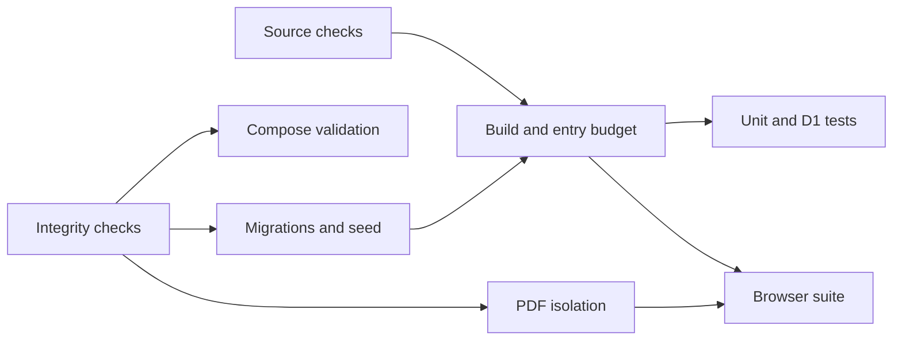

# CI performance contract

Each ordinary workflow executes the complete native suite once for its exact
revision. The full requirement map, individual case accounting, expected
platform exclusions, native assertions and no-flaky-success policy remain
authoritative. PR merge candidates and merged commits require separate
execution. Named receipt checks are validation of the native producer, not
independent test runs.

## Baseline and budgets

The September 21 UTC baseline is PR run `35548798219` plus pilot run
`35548798262`: ordinary PR checks took 96.1 minutes elapsed, including a
separate 47.9-minute pilot using the same runner. The pilot's required execution
step took 46.0 minutes; ordinary quality and browser jobs took 26.9 and 19.5
minutes. Dependency setup was approximately 16 seconds per job. These are
observations, not fixed machine benchmarks; compare active execution separately
from waiting.

The complete successful merged run `35645412914` at `fa9db84b` is the baseline
for bounded parallel execution: 2,616.849 seconds active, including 1,168.481
seconds for browsers and 885.347 seconds for unit/D1 tests. PDF isolation took
232.225 seconds and source checks 226.340 seconds. It passed 1,151 unit/D1 cases
and 288 browser cases, with 44 reviewed browser exclusions and no flakes.

`.tugling/pilot.json` enforces a 1,800-second active native budget. The complete
receipt records elapsed execution time, each flow duration and a sorted timing
summary. Concurrent flow durations are not added to claim wall-clock time.
Exceeding that budget fails required verification without silently dropping
checks. Watchdogs remain independent safety ceilings. Do not raise the budget to
hide a regression.

Use Actions job creation/start/completion timestamps to measure queue and setup
time separately. Compare complete successful workflows at the same coverage; do
not count cancelled or filtered runs as speed improvements. Desired future
service targets are p95 queue under two minutes and p95 PR completion under 15
minutes. These are service targets, not a claim established by one successful
run.

## Capacity and further reductions

One `keel-ci` runner currently serializes verification. Adding YAML jobs alone
does not add capacity. The host also serves other workloads; measure peak CPU,
memory, I/O and queue pressure before adding runners or increasing worker
counts. Keep the credential-bearing deployment account separate.

Prioritize the real D1 cost fixtures and browser tests using measured receipt
and native-report timings. Preserve the full-day provider scenarios and real D1
cost assertions. Browser tests that share mutable D1 state remain serial.
Parallel browser cases must use the reviewed API-mocked lane, reject unexpected
application API calls, and own their browser context and fixture state.
Parallelizing the stateful lane would require independent D1 directories,
servers, ports and cleanup.

## Bounded execution plan

The verification map opts into at most two concurrent native flows. Source
checks and integrity checks can start together. Migration and PDF probes depend
on integrity checks. Build depends on source checks and migration completion;
unit/D1 tests depend on build. Browser tests depend on build and PDF isolation.
This keeps generated outputs stable before their consumers start and avoids
running browser document processing before the sandbox boundary passes.
Formatting and linting exclude the Git-ignored runtime, fixture and cache
directories, so concurrent integrity tests cannot change files under the source
checkers. Repository source and test files remain in scope.

The declared prerequisites are:

Only two ready flows execute at once; an arrow means the prerequisite must
finish successfully. The browser suite runs its stateful lane before its mocked
lane, each with a separately owned server lifetime.

The unit suite retains its two-worker ceiling. The browser runner executes the
stateful lane with one worker, then the isolated mocked lane with two workers.
The reviewed partition contains 106 mocked executions and 226 stateful
executions, including the existing 44 platform exclusions. The parallel group
contains agreement security, automatic investment review, company names, holding
details, holding imports, investment holdings and investment review. The guard
exposed additional application reads in legal entities, legal-name resolution,
portfolio dashboard and purchase details; those remain serial. The lanes keep
existing desktop/mobile project names, screenshots and case identities. A new or
unclassified spec fails the partition check. Both reports are combined and
checked against the entire reviewed browser inventory; one green lane cannot
substitute for the complete suite. Native report leases are per suite, so
independent writers can overlap but duplicate suite invocations cannot replace
an active report.

The initial OVH capacity inspection found six CPUs, 11.4 GiB RAM, approximately
9.3 GiB available memory and low CPU/I/O pressure. This is a starting snapshot,
not peak-load proof. Measure pressure during complete concurrent runs before
raising either concurrency limit. One native runner job still owns all work; no
additional persistent runner or deployment credential access is introduced.

Failure, timeout, cancellation, missing cases, duplicate cases and flaky retry
success remain failures. The scheduler stops admitting dependent work after a
failure and cleans up only process groups it owns. Exact project, map, helper,
environment, run and attempt binding remains mandatory for receipt consumers.

Validation includes real scheduler dependency/overlap and cleanup holdouts,
browser partition and unexpected-API rejection checks, same-suite lock
contention across processes, swapped-lane/worker-count rejection and
missing/duplicate lane report rejection. The browser guard is exercised through
real Chromium: a known synthetic GET succeeds, while an unknown GET and an
unexpected POST to a read-only fixture fail. Delivery requires a complete
successful exact-revision PR gate, merged-revision gate and protected preview
smokes. A faster filtered or failed run is not a performance result.

## Test layers

Use unit tests for pure scheduling and decision rules, fast SQLite integration
for SQL-backed behavior, and real D1 for billing counters, index maintenance,
migration compatibility and scale holdouts. SQLite changed-row counts cannot
stand in for D1 billed writes. Keep browser coverage for actual user workflows
and Worker runtime boundaries, without repeating every decision permutation.

Provider document permutations retain the real DOM, popups, source association,
downloads, PDF extraction and cache/backfill assertions. Nine redundant scanner
loads are replaced with current synthetic scan receipts, with exact scan-count
assertions for cache reuse, extractor upgrades, expiry and resumed backfills.
The production tsx smoke retains the real scanner/extractor boundary, and the
dedicated PDF suite retains real adversarial scanner and isolation checks.

The provider full-day gate runs all five scenarios through the production
client, web proxy, API, authentication and repositories using in-memory SQLite.
It records every SQL operation, binding, result and atomic batch, then replays
the complete trace inside workerd. Every D1 result must match. The original
HTTP, Worker invocation, round-trip and actual D1 billing ceilings still apply;
no averages, sampled requests or shorter virtual days replace them. The replay
fixture rejects unsupported metadata-dependent behavior rather than supplying
fake D1 metadata. Required browser tests continue to cover Worker HTTP behavior.

`scripts/sql-replay.test.ts` checks result divergence, missing operations,
missing metadata, transaction rollback, setup exclusion and real index-write
billing. A negative-control experiment restoring one-minute heartbeat writes
rejected 8,637 billed writes against the unchanged 2,000-write ceiling. The
fixed idle day reads 77,165 rows and writes 1,725, matching the previous harness
exactly. All five scenarios retained their previous measured billing totals.

On the same local macOS checkout, the old idle case took 33.6 seconds and replay
took 13.3 seconds. The complete five-scenario replay suite took 57.4 seconds.
These local measurements do not establish OVH timings or the 15-minute target.
Use the native timing receipt and Vitest artifact for the eventual OVH
comparison.

The private-continuity D1 holdout runs its unmeasured synthetic setup inside the
same workerd database: initial legacy holdings, three complete same-date history
imports and an unrelated household. This avoids repeated cross-process setup
transport while retaining the production import repositories, all 120 items and
real database constraints. The measured import, reconciliation, retry, read and
query-plan assertions still use actual D1 metadata. Its 90-second watchdog and
all billing ceilings remain unchanged.

The 120-position baseline holdout retains one actual review transition and
directly seeds the other 118 historical reviews using schema-validated states
and normal database triggers. All history, unrelated-household, retained
exception, query-plan and read/write ceilings remain. Review workflow and
stale-evidence behavior remain covered by their dedicated integration tests.

## Failure and recovery

Native CI uses loopback ports 31000/31001, outside local development ranges and
OVH's Linux ephemeral range (32768-60999). A preflight checks both availability
and the live kernel range before expensive verification. This avoids automatic
outbound-port allocation colliding with browser startup after the unit suite; it
does not reserve ports against unrelated explicit listeners. The browser server
still fails closed on a later conflict and never reuses another server. Keep one
native job per dedicated runner and do not kill an unknown port owner.

Receipt consumers require the producer's success, the exact artifact name from
the current run, and matching project/config/map/helper/environment/run/attempt
identities. Missing, failed, partial, expired or stale evidence fails closed.
Rerun the entire workflow: rerunning only a consumer in a new attempt correctly
rejects evidence from the previous attempt. Receipt artifacts expire after seven
days; learning ledgers and provider data are never uploaded.

Receipt jobs skip cancelled workflows so obsolete runs release their concurrency
slot instead of waiting for the shared runner. A failed native producer still
runs the receipt jobs, which reject its unsuccessful result before downloading.

The manual candidate workflow retains the synthetic polling-regression rejection
experiment. Post-merge native verification, secret scanning, pinned released
adapter validation, protected backup/migration/deployment and smoke checks
remain required before claiming preview delivery.
