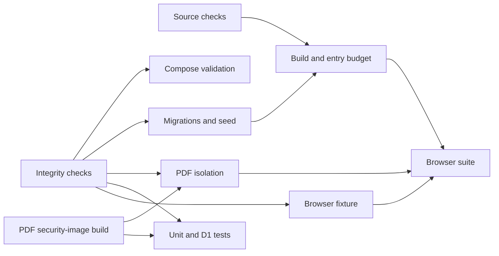

# CI performance contract

Each ordinary workflow executes the complete native suite once for its exact
revision. The full requirement map, individual case accounting, expected
platform exclusions, native assertions and no-flaky-success policy remain
authoritative. PR merge candidates and merged commits require separate
execution. Named receipt checks are validation of the native producer, not
independent test runs.

## Baseline and budgets

The September 21 UTC baseline is PR run `35548798219` plus pilot run
`35548798262`: ordinary PR checks took 96.1 minutes elapsed, including a
separate 47.9-minute pilot using the same runner. The pilot's required execution
step took 46.0 minutes; ordinary quality and browser jobs took 26.9 and 19.5
minutes. Dependency setup was approximately 16 seconds per job. These are
observations, not fixed machine benchmarks; compare active execution separately
from waiting.

The complete successful merged run `35645412914` at `fa9db84b` is the baseline
for bounded parallel execution: 2,616.849 seconds active, including 1,168.481
seconds for browsers and 885.347 seconds for unit/D1 tests. PDF isolation took
232.225 seconds and source checks 226.340 seconds. It passed 1,151 unit/D1 cases
and 288 browser cases, with 44 reviewed browser exclusions and no flakes.

`.tugling/pilot.json` enforces a 900-second active native budget. The complete
receipt records elapsed execution time, each flow duration and a sorted timing
summary. Concurrent flow durations are not added to claim wall-clock time.
Exceeding that budget fails required verification without silently dropping
checks. Watchdogs remain independent safety ceilings. Do not raise the budget to
hide a regression.

Use Actions job creation/start/completion timestamps to measure queue and setup
time separately. Compare complete successful workflows at the same coverage; do
not count cancelled or filtered runs as speed improvements. Desired future
service targets are p95 queue under two minutes and p95 PR completion under 15
minutes. These are service targets, not a claim established by one successful
run.

## Capacity and further reductions

One `keel-ci` runner currently serializes verification. Adding YAML jobs alone
does not add capacity. The host also serves other workloads; measure peak CPU,
memory, I/O and queue pressure before adding runners or increasing worker
counts. Keep the credential-bearing deployment account separate.

Run the small release gates before admitting expensive native verification on
this single runner. PR native verification waits for its secret scan; post-merge
native verification waits for both the full-history secret scan and the pinned
Tugling project contract. Preview still depends on all three gates. This
prevents a completed native run from waiting behind another long native job
merely to finish its small release checks. It does not eliminate queueing before
verification or add capacity for simultaneous native runs.

The need was observed in merged run `35771028409`: native verification passed at
19:14:10 UTC, but a Dependabot native job occupied the runner from 19:14:45 to
19:27:47. The contract and secret scan completed only at 19:28:14 and 19:28:27,
so preview finished at 19:30:01. Native execution itself took 698.799 seconds
(11m39s), versus 1,337.720 seconds before this optimization round. Its browser
flow took 425.105 seconds and unit/D1 flow 511.484 seconds; 1,159 unit tests and
288 browser cases passed, with 44 unchanged browser exclusions and no flakes.
The 28m52s end-to-end workflow includes that queue gap and must not be
represented as an 11m39s delivery.

Prioritize the real D1 cost fixtures and browser tests using measured receipt
and native-report timings. Preserve the full-day provider scenarios and real D1
cost assertions. Browser tests that share mutable D1 state remain serial.
API-mocked cases reject unexpected application API calls and own their browser
contexts and fixtures. Stateful partitions use independent D1 directories,
servers, ports and cleanup; each partition remains serial internally.

## Bounded execution plan

The verification map opts into at most three concurrent native flows. Source
checks, integrity checks and the PDF security-image build can start together.
Migration depends on integrity checks; PDF probes depend on both integrity and
the successful image build. Browser fixture preparation also becomes ready after
the integrity checks and enters the three-flow schedule when a slot opens. Build
depends on source checks and migration completion. Unit/D1 tests become ready
after integrity checks and the PDF image build, and take the first available
slot before migration and fixture preparation. They own isolated D1 fixtures and
consume TypeScript sources, so source checks, the shared scenario seed and build
output are not inputs to this flow. Source checks and migration remain required
for the complete gate. The exact real-reader name/page assertions now belong to
mandatory PDF isolation, outside Vitest’s unit pool. Browser tests depend on the
sealed fixture, build and PDF isolation. This keeps generated outputs stable
before their browser consumers start and avoids running browser document
processing before the sandbox boundary passes. Formatting and linting exclude
the Git-ignored runtime, fixture and cache directories, so concurrent integrity
tests cannot change files under the source checkers. Repository source and test
files remain in scope.

The declared prerequisites are:

Only three ready flows execute at once; an arrow means the prerequisite must
finish successfully. Source checks use at most two Make jobs, and PDF proof uses
one independently limited container per daemon across processes. Kernel
ownership serializes the scanner/reader and adversarial sequences through
confirmed cleanup; all original probes remain required. The fixture uses a slot
released by an earlier flow and can overlap remaining source/PDF work. No
browser consumer starts before its fixture, PDF isolation and build succeed.

The unit suite uses three workers in CI and two locally, and starts historically
expensive files first. Its early admission reduces overlap between expensive D1
fixtures and browser startup. Browser verification produces five reports while
admitting at most four workers: three stateful partitions, 74 API-mocked
executions served from the verified production build, and 32 API-mocked
executions that require Vite development modules. The initial four lanes each
use one worker. After all four reports and runtimes validate and close, the
development mocked lane uses the released four-worker budget. No stateful lane
is parallelized. The development stateful partition contains four specs and 58
executions: three depend on source modules, while Portfolio Watch asserts
development-mode demo-source disclosure. The other two stateful partitions
contain 96 and 72 executions and use the verified production build, as does the
production mocked lane. The partitions contain the same 106 mocked and 226
stateful executions, including 44 reviewed platform exclusions. Each stateful
partition receives a separate copy of the verified, closed synthetic seed and
owns distinct API/web ports. Neither mocked lane starts an API server.
Production serving reduces module transforms and requests; development serving
retains the direct source-module checks and the intentional demo-source
disclosure. Missing production JS or CSS fails startup. All lanes keep
desktop/mobile project names, snapshots and case identities. Each lane owns its
Vite dependency cache as well as its browser output. Development readiness
transforms the initial application and Holdings module graph and rejects broken
imports before admitting tests. Stateful readiness also checks the actual
holdings-page projection through the web proxy, with one bounded probe in flight
and a cached successful result for the development server. A simpler health
endpoint cannot hide a cold first read or module load.

Fixture preparation runs the unchanged browser reset, every migration, the
synthetic seed and invariant readback early in the bounded flow graph. It moves
the closed result into a dedicated allowlisted path and seals both the source
inputs and complete fixture contents. The required browser command only accepts
that seal, clones three profiles and consumes the seed; it never falls back to a
reset on the browser critical path. The standalone `pilot_native.py playwright`
command retains its reset-and-verify behavior and uses a separate seed path.
Both commands share the Playwright lease while touching browser runtime/report
paths.

Stateful Wrangler instances use OS-assigned inspector ports so debugger
listeners cannot collide even though application ports are distinct.

The image build is an explicit required flow, with its failure, timing and
cancellation included in the exact-revision receipt and 900-second budget. Daily
`SECURITY_REFRESH_DATE` package refresh, freshclam signature refresh,
rootless-engine validation, immutable digests, atomic configuration writes and
the clean-scanner preflight remain unchanged. No consumer uses partially built
images. Native and manual pilot workflows do not build the images a second time
outside the dependency graph.

The September 23 UTC cold refresh in run `35800328085` took 120 seconds before
the native gate: approximately 56 seconds for the reader/base and 63 seconds for
the scanner, with a cached probe. Using the measured flow durations and
three-slot schedule, moving that build into the graph projects approximately 92
seconds (11%) saved on this cold path. Warm builds around 25 seconds offer about
3% savings. This is a scheduling projection, not a measured cold run of the new
graph; source/build contention can change the result. Preserve daily security
freshness rather than skipping refreshes to meet the budget.

CI uses `make bootstrap-ci` for the toolchain, locked dependencies and Chromium.
The required migration flow owns the default database reset and readback. The
developer `make bootstrap` still seeds a ready-to-use local database. Removing
the duplicate CI reset does not remove the migration or seed verification.

New or unclassified specs fail partition validation. All five reports must
individually match their partition and jointly match the complete reviewed
inventory; one green lane cannot substitute for the suite. Merged elapsed time
is the span of the concurrent lanes, not their summed work. Per-suite leases
reject duplicate writers, and cancellation cleans owned process groups before
removing the isolated database profiles. The reviewed dependency map is exact:
only the development mocked lane waits, and it cannot start until all four
initial lanes have validated their reports and released their process groups and
ports.

The initial OVH capacity inspection found six CPUs, 11.4 GiB RAM, approximately
9.3 GiB available memory and low CPU/I/O pressure. This is a starting snapshot,
not peak-load proof. Measure pressure during complete concurrent runs before
raising either concurrency limit. One native runner job still owns all work; no
additional persistent runner or deployment credential access is introduced.

Failure, timeout, cancellation, missing cases, duplicate cases and flaky retry
success remain failures. The scheduler stops admitting dependent work after a
failure and cleans up only process groups it owns. Exact project, map, helper,
environment, run and attempt binding remains mandatory for receipt consumers.

Validation includes real scheduler dependency/overlap and cleanup holdouts,
browser partition and unexpected-API rejection checks, same-suite lock
contention across processes, swapped-lane/worker-count rejection and
missing/duplicate lane report rejection. The browser guard is exercised through
real Chromium: a known synthetic GET succeeds, while an unknown GET and an
unexpected POST to a read-only fixture fail. Delivery requires a complete
successful exact-revision PR gate, merged-revision gate and protected preview
smokes. A faster filtered or failed run is not a performance result.

## Test layers

Use unit tests for pure scheduling and decision rules, fast SQLite integration
for SQL-backed behavior, and real D1 for billing counters, index maintenance,
migration compatibility and scale holdouts. SQLite changed-row counts cannot
stand in for D1 billed writes. Keep browser coverage for actual user workflows
and Worker runtime boundaries, without repeating every decision permutation.

Provider document permutations retain the real DOM, popups, source association,
downloads, PDF extraction and cache/backfill assertions. Nine redundant scanner
loads are replaced with current synthetic scan receipts, with exact scan-count
assertions for cache reuse, extractor upgrades, expiry and resumed backfills.
The production tsx smoke retains the real scanner/extractor boundary, and the
dedicated PDF suite retains real adversarial scanner and isolation checks.

The provider full-day gate runs all five scenarios through the production
client, web proxy, API, authentication and repositories using in-memory SQLite.
It records every SQL operation, binding, result and atomic batch, then replays
the complete trace inside workerd. Every D1 result must match. The original
HTTP, Worker invocation, round-trip and actual D1 billing ceilings still apply;
no averages, sampled requests or shorter virtual days replace them. The replay
fixture rejects unsupported metadata-dependent behavior rather than supplying
fake D1 metadata. Required browser tests continue to cover Worker HTTP behavior.

Session setup and browser reconnect checks use the same complete-trace proof.
Each test retains its shared application and trace state across scenarios. Each
measurement checkpoint replays the accumulated trace into a fresh D1 database,
excluding prior setup and scenarios from that checkpoint's billed region. This
preserves state transitions without applying a write twice to one replay target.
Every scenario still checks its full request count and actual D1 billing.

The collection read-budget fixture meters both production capture passes beside
D1 and returns their actual counters, query diagnostics and continuity count for
the original assertions. Only the remaining proposal, Watch, connection and
unrelated-household setup is unmeasured. All eight read, discovery, race and
history cases retain their original request paths, ceilings and watchdogs.

`scripts/sql-replay.test.ts` checks result divergence, missing operations,
missing metadata, transaction rollback, setup exclusion and real index-write
billing. A negative-control experiment restoring one-minute heartbeat writes
rejected 8,637 billed writes against the unchanged 2,000-write ceiling. The
fixed idle day reads 77,165 rows and writes 1,725, matching the previous harness
exactly. All five scenarios retained their previous measured billing totals.

On the same local macOS checkout, the old idle case took 33.6 seconds and replay
took 13.3 seconds. The complete five-scenario replay suite took 57.4 seconds.
These local measurements do not establish OVH timings or the 15-minute target.
Use the native timing receipt and Vitest artifact for the eventual OVH
comparison.

The private-continuity D1 holdout runs its unmeasured synthetic setup inside the
same workerd database: initial legacy holdings, three complete same-date history
imports and an unrelated household. This avoids repeated cross-process setup
transport while retaining the production import repositories, all 120 items and
real database constraints. The measured import, reconciliation, retry, read and
query-plan assertions still use actual D1 metadata. Its 90-second watchdog and
all billing ceilings remain unchanged.

The same boundary applies to holdings, Portfolio Watch, automatic-investment,
participation, company-identity and investment-event fixtures: only unmeasured
setup moves beside D1. Production repositories, real review transitions,
append-only history, unrelated households and database constraints remain.
Measured client/API requests still run through their original path.

The purchase-history holdout runs all 960 production accepts beside D1,
resetting the real meter for each operation. It returns all 960 billing records
and all eight history-read records for the unchanged per-operation assertions.
Ordered position/version accounting and a 960-receipt database readback reject
partial execution; household isolation and query-plan checks remain on the host.
No write transactions are combined and no billing values are synthesized.

The source-capture write-budget holdout also executes beside D1, with its meter
covering every setup, capture and automatic-review operation. It retains all 120
investments, 24 captured documents, 96 exceptions and the combined 8,000-write
ceiling. The source/capture/review measurement boundaries remain unchanged; only
the host transport is removed.

The 120-position baseline holdout retains one actual review transition and
directly seeds the other 118 historical reviews using schema-validated states
and normal database triggers. All history, unrelated-household, retained
exception, query-plan and read/write ceilings remain. Review workflow and
stale-evidence behavior remain covered by their dedicated integration tests.

## Failure and recovery

PR run `37951901830` exposed contention across independent native and browser
fixtures: one attempt timed out an unchanged cash cost case at 60 seconds; the
next timed out an unchanged cash integration case at five seconds and a browser
waiting for its initial portfolio read at 30 seconds. Host samples around the
second failures averaged 90.1% CPU busy with CPU pressure reaching 66.19%.
Reducing Vitest to two workers removed those failures in run `37960063713`: all
328 browser cases passed, but the complete gate exhausted its 900-second budget
with unit work still unfinished. Admit the unit flow immediately after its real
integrity and image prerequisites, before migration and browser preparation, and
retain three CI workers. This starts the costly native fixtures earlier instead
of reducing throughput across the entire suite. Keep all cases, assertions,
watchdogs, retries and the 900-second complete-gate budget unchanged. These
failed runs diagnose scheduling and contention; they do not prove the revised
schedule's readiness or performance. Only a complete exact-revision receipt can
establish that.

Run `37963326704` completed 1,259 unit cases but timed out the remaining rename
scale fixture at 300 seconds. It started late, during browser execution; host
samples during it averaged 90.3% CPU busy with pressure reaching 73.74%. That
fixture lacked a scheduling hint despite its completed 200-second execution in
run `37951901830`. Include that observed duration in the existing longest-first
sequencer so the fixture starts in the early native pool. Its 120-position
scale, historical and foreign-household cases, D1 limits and watchdog remain
unchanged.

Native CI uses loopback web ports 31031–31035 and API ports 32032, 32033 and
32035, outside local development ranges and OVH's Linux ephemeral range
(32768-60999). A preflight checks port availability and the live kernel range
before expensive verification. This avoids automatic outbound-port allocation
colliding with browser startup after the unit suite; it does not reserve ports
against unrelated explicit listeners. The browser server still fails closed on a
later conflict and never reuses another server. Keep one native job per
dedicated runner and do not kill an unknown port owner.

Receipt consumers require the producer's success, the exact artifact name from
the current run, and matching project/config/map/helper/environment/run/attempt
identities. Missing, failed, partial, expired or stale evidence fails closed.
Rerun the entire workflow: rerunning only a consumer in a new attempt correctly
rejects evidence from the previous attempt. Receipt artifacts expire after seven
days; learning ledgers and provider data are never uploaded.

Receipt jobs skip cancelled workflows so obsolete runs release their concurrency
slot instead of waiting for the shared runner. A failed native producer still
runs the receipt jobs, which reject its unsuccessful result before downloading.

The manual candidate workflow retains the synthetic polling-regression rejection
experiment. Post-merge native verification, secret scanning, pinned released
adapter validation, protected backup/migration/deployment and smoke checks
remain required before claiming preview delivery.

## September 22 optimization experiment

The next measured round targets the complete native gate, using merged run
`35690710837` (1,337.720 seconds) as its baseline. Browser elapsed time was
959.120 seconds; unit/D1 elapsed time was 1,056.354 seconds. Both branches must
improve because their completion times differ by only 55 seconds.

The experiment preserves every reviewed case, desktop/mobile variant, real D1
billing assertion, migration boundary, failure outcome, and exact-revision
receipt. It changes only test transport, unmeasured fixture initialization and
scheduling. Each accepted optimization must pass focused integrity tests and the
complete OVH gate; timing from a failed or filtered run is diagnostic only.

Execution slices:

1. Profile provider initialization, scenario execution and D1 replay separately.
   Batch only consecutive standalone SELECTs during synthetic replay, keeping
   all results and actual rows-read/write metadata. Preserve original production
   round-trip accounting independently of replay transport calls. Never combine
   writes, existing transactions or setup/measurement boundaries.
2. Move repeated unmeasured D1 initialization and scale-fixture setup beside the
   database, keeping a fresh database per test and all measured operations.
3. Run three independently seeded stateful browser partitions and separate
   production/development mocked partitions with distinct ports, runtime state,
   diagnostics and owned cleanup. Compare their complete union with the
   unchanged reviewed browser inventory.
4. Overlap read-only source checks with `make -j2`, and permit three native
   flows so PDF isolation can overlap migration verification. Build and consumer
   prerequisites remain explicit; runtime and migration outputs are not shared.
5. Keep scanner/reader and kernel-probe sequences independent, but serialize
   actual containers through one cross-process daemon owner with unchanged
   limits. Prove caller death and racing real readers without retries. Wait for
   both branches and confirmed cleanup before checking for leftovers.
6. Start the historically expensive Vitest files first, preserving discovered
   specifications and test order within each file. This avoids a large final
   fixture leaving the other workers idle.
7. Inspect the resulting critical path and host resource pressure. Pursue
   another candidate when its credible complete-gate improvement exceeds 5%;
   validate promising scheduling choices with a complete same-host comparison.

The stopping report must distinguish measured savings, rejected experiments, and
untested architectural opportunities. A finite benchmark cannot prove that no
possible future optimization exceeds 5%. No additional runner, larger host,
removed assertion, relaxed watchdog or increased retry count is assumed.

The native job owns one read-only host-counter observer during verification. It
reads CPU, memory, swap and pressure counters every five seconds, with at most
361 samples and an independent 30-minute deadline. The job stops and reaps it on
success or failure; observer errors do not trigger retries or application
requests. It performs no network, D1 or object-storage work. Diagnostics share
the existing seven-day artifact retention and contain no process arguments,
credentials or portfolio data.

## Evaluated remaining source-check optimizations

An unchanged two-job local source run took 50.19 seconds: lint took 48.47
seconds and typecheck 29.69 seconds. Repeating it with ESLint's supported
`--concurrency 2`, without caching or selection changes, took 54.27 seconds:
lint stayed at 48.41 seconds while typecheck rose to 40.75 seconds. Separate
ESLint workers duplicate their TypeScript project services and increased CPU
work. Keep lint concurrency disabled.

The lint command gives its single Node process a 4 GiB old-space ceiling. PR run
`37834913601` exhausted Node 22's default 2 GiB heap while the runner still had
at least 5 GiB available throughout the sampled gate. Apply this limit only to
ESLint, whose type-aware project services retain the workspace type graph; do
not increase every concurrent Node process's allowance. Full file selection,
type-aware rules and zero-warning enforcement remain unchanged.

OVH run `35764220712` is diagnostic evidence, not a successful-gate benchmark:
source checks took 167.974 seconds, with typecheck finishing approximately 28
seconds before lint. A TypeScript-only cache cannot advance that source
boundary, and even zero-time lint cannot remove the remaining typecheck work.
Ordinary per-file lint caching is unsafe for type-aware rules when imported
types change. Keep the full checks; removing repeated parsing would require a
separately measured design that preserves every workspace's type environment.
